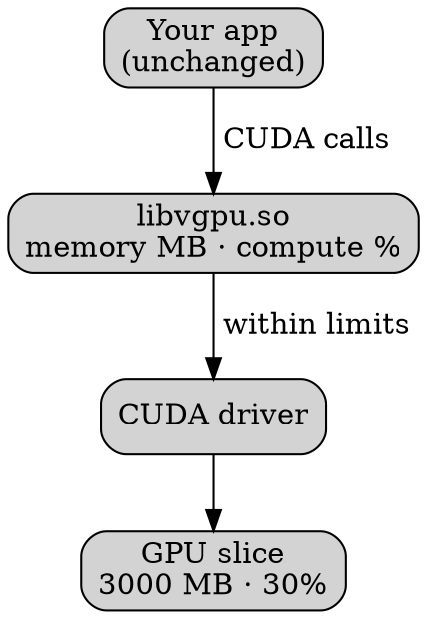
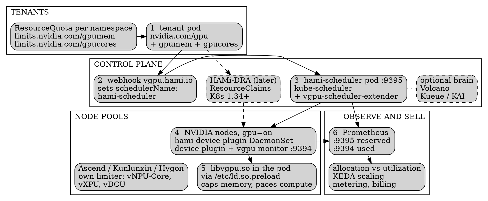
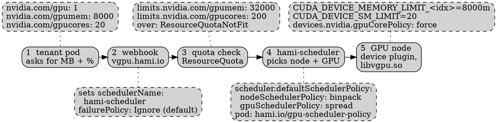
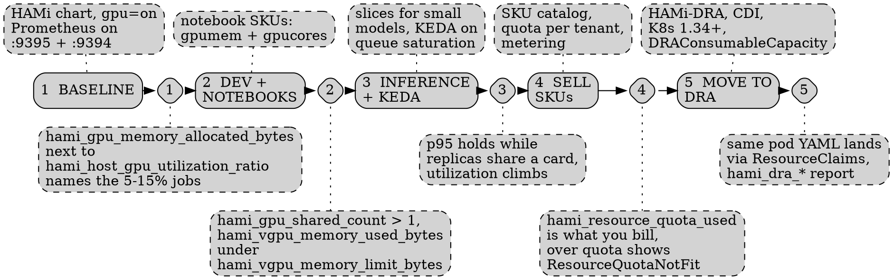
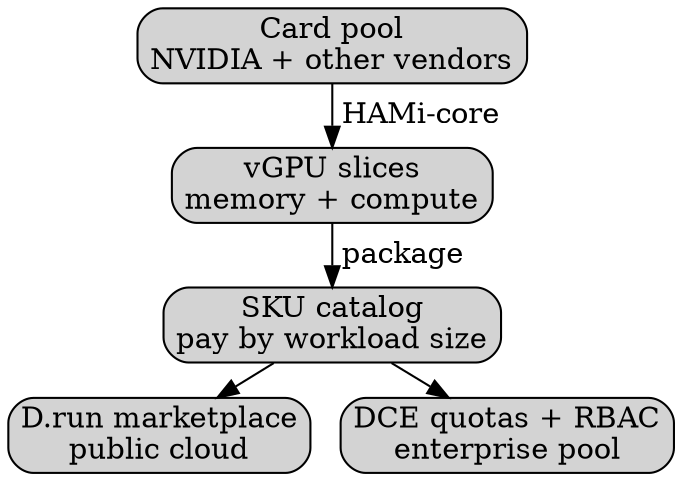

```dot
digraph G {
  rankdir=TB
  newrank=true
  compound=true
  nodesep=0.08
  ranksep=0.22
  node [shape=box style="rounded,filled" margin="0.06,0.03"]
  sch [label="hami-scheduler: one cluster, three pools\nroutes by what the pod asks for" class="cyan"]
  subgraph cluster_p1 {
    label=""
    i1 [shape=plaintext style="" label="1  WHOLE-CARD POOL\lgpu=on, taint pool=training\lpod asks: nvidia.com/gpu: 8\l"]
    subgraph cluster_p1g0 { label="" margin=4
      p1g0c0 [label="GPU" class="green"]
    }
    subgraph cluster_p1g1 { label="" margin=4
      p1g1c0 [label="GPU" class="green"]
    }
    subgraph cluster_p1g2 { label="" margin=4
      p1g2c0 [label="GPU" class="green"]
    }
    subgraph cluster_p1g3 { label="" margin=4
      p1g3c0 [label="GPU" class="green"]
    }
    f1 [shape=plaintext style="" label="policy: node binpack, GPU mutex\lruns: training, large LLMs\lSKU: 1 or 8 whole cards\l"]
  }
  subgraph cluster_p2 {
    label=""
    i2 [shape=plaintext style="" label="2  MIG POOL\lgpu=on, operatingmode: mig\lpod asks: vgpu-mode: mig\l"]
    subgraph cluster_p2g0 { label="" margin=4
      p2g0c0 [label="2g.12gb" class="green"]
      p2g0c1 [label="1g.6gb" class="green"]
      p2g0c2 [label="free" style="rounded,filled,dashed"]
    }
    subgraph cluster_p2g1 { label="" margin=4
      p2g1c0 [label="4g.24gb" class="green"]
    }
    f2 [shape=plaintext style="" label="annotation: nvidia.com/vgpu-mode\lruns: untrusted tenants\lSKU: MIG profile (A30 example)\l"]
  }
  subgraph cluster_p3 {
    label=""
    i3 [shape=plaintext style="" label="3  SHARED POOL, HAMi-core\lgpu=on, operatingmode: hami-core\lpod asks: gpumem + gpucores\l"]
    subgraph cluster_p3g0 { label="" margin=4
      p3g0c0 [label="2000 MB\n30%" class="green"]
      p3g0c1 [label="8000 MB\n20%" class="green"]
      p3g0c2 [label="free" style="rounded,filled,dashed"]
    }
    subgraph cluster_p3g1 { label="" margin=4
      p3g1c0 [label="15000 MB\n30%" class="green"]
      p3g1c1 [label="free" style="rounded,filled,dashed"]
    }
    f3 [shape=plaintext style="" label="policy: node binpack, GPU spread\lruns: inference, dev, notebooks\lSKU: MB + %, sizes are examples\l"]
  }
  i1 -> p1g0c0 [style=invis]
  p1g0c0 -> f1 [style=invis]
  i2 -> p2g0c0 [style=invis]
  p2g0c0 -> f2 [style=invis]
  i3 -> p3g0c0 [style=invis]
  p3g0c0 -> f3 [style=invis]
  {rank=same; i1; i2; i3}
  {rank=same; p1g0c0; p1g1c0; p1g2c0; p1g3c0; p2g0c0; p2g0c1; p2g0c2; p2g1c0; p3g0c0; p3g0c1; p3g0c2; p3g1c0; p3g1c1}
  {rank=same; f1; f2; f3}
  sch -> i1 [lhead=cluster_p1]
  sch -> i2 [lhead=cluster_p2]
  sch -> i3 [lhead=cluster_p3]
}
```

<!--
0.5 min. 25 min talk, ContainerDays 2026 Singapore, Tuesday Oct 27. Blueprint deck: the five-layer neocloud stack, bottom-up, with production evidence attached to every layer. It follows the abstract's order: why DRA is not enough, enforcement, scheduling, DRA, production patterns, overhead and best fit, limits, blueprint.
Sources for every number: research/containerdays-sg-2026/case-studies.md (11 CNCF case studies from 10 organisations, cncf.io/case-studies, filter project HAMi) plus our own H200 measurement from the Viettel Cloud work.
Timing: waste + DRA + map 3.75 min, layers 1-2 5 min, layers 3-5 3.5 min, overhead + 10x + limits 4.5 min, blueprint (architecture, pools, config, rollout) 6.75 min.
Open: "Who here sells GPU capacity? Who buys it? Who runs both?" Then: I work with neoclouds and GPU vendors across APAC. This talk is the stack they end up building, layer by layer, with what ten production users measured at each layer. No vendor pitch: I will show where it does not work too.
-->
@variant dark
@side-image assets/qr-hami-repo.png
@kicker ContainerDays 2026 Singapore · CNCF Incubating project

# 10x Your Neocloud's GPU Utilization with HAMi

@subtitle A blueprint from ten production users

@speaker name="Reza Jelveh" role="Head of Global Market, Dynamia" github=github.com/fishman linkedin=linkedin.com/in/rezajelveh

---

<!--
1.5 min. The hook: a GPU box is not a GPU cloud.
Seven independent measurements, before any sharing:
- NIO (autonomous driving), CI/testing on full GPUs: 5-10%. CI is mostly CPU: compile, fetch, preprocess.
- PREP EDU (RTX 4070/4090, on-prem): 10-20% with static allocation.
- CETC Cloud: an embedding model held a whole 64 GB card and used 8 GB: 12.5% of VRAM. That one is memory, not SM.
- Ke Holdings: 13% across the whole platform. Platform-wide, mixed training and inference, not one workload.
- Zhuoyu: dev environments and small inference below 15%. Upper bound only, so the bar is hatched.
- Sangfor: small models 15-20%, one card one model.
- Our own H200 on Viettel Cloud: a time-series inference job used 1 GB of 141 GB, SM 16-18%.
I did not average anything; units are labelled. The cause is the Kubernetes default: nvidia.com/gpu: 1, the whole card or nothing.
Line to land: nobody here has a capacity problem, they have an allocation problem. A neocloud that rents whole cards sells this waste to its customers, or eats it.
-->

## Seven organisations measured the same 5-20%

@subtitle Utilization before sharing, as each team reported it (workload, platform and VRAM measures differ)

```seaborn
fg = plt.rcParams["text.color"]
dim = plt.rcParams["xtick.color"]
cmap = plt.get_cmap("Paired")
used = cmap(5.5 / 12)
used_l = cmap(4.5 / 12)
track = "#e5e7eb"
plt.rcParams["patch.force_edgecolor"] = False

fig, ax = plt.subplots(figsize=(11.4, 4.0))
fig.subplots_adjust(left=0.005, right=0.995, top=0.995, bottom=0.005)
ax.set_facecolor("none")
fig.patch.set_alpha(0)
ax.grid(False)

rows = [
    ("NIO", "CI / testing", 5, 10, "5-10%", "range"),
    ("PREP EDU", "inference, RTX 4070/4090", 10, 20, "10-20%", "range"),
    ("CETC Cloud", "embedding model, VRAM", 12.5, 12.5, "12.5%", "point"),
    ("Ke Holdings", "platform-wide, mixed training + inference", 13, 13, "13%", "point"),
    ("Zhuoyu", "dev envs, small inference", 0, 15, "<15%", "upper"),
    ("Sangfor", "small models", 15, 20, "15-20%", "range"),
    ("Own H200", "time-series inference, SM", 16, 18, "16-18%", "range"),
]
n = len(rows)
for i, (org, what, lo, hi, txt, kind) in enumerate(rows):
    y = n - 1 - i
    ax.barh(y, 100, color=track, height=0.66, zorder=1)
    if kind == "upper":
        ax.barh(y, hi, color=used_l, height=0.66, hatch="///", edgecolor=used, linewidth=0, zorder=2)
    else:
        ax.barh(y, lo, color=used, height=0.66, zorder=2)
        if hi > lo:
            ax.barh(y, hi - lo, left=lo, color=used_l, height=0.66, zorder=2)
    ax.text(hi + 1.5, y, txt, ha="left", va="center", fontsize=14, color=fg, fontweight="bold", zorder=3)
    ax.text(33.5, y, what, ha="left", va="center", fontsize=12, color=dim, zorder=3)
    ax.text(-1.5, y, org, ha="right", va="center", fontsize=14, color=fg, fontweight="bold")

ax.text(100, n - 0.5, "one whole card = 100%", ha="right", va="bottom", fontsize=12, color=dim)
ax.text(-19, n - 0.5, "SOLID = LOW END   LIGHT = REPORTED RANGE   HATCHED = UPPER BOUND ONLY",
        ha="left", va="bottom", fontsize=10, color=dim, family="monospace")
ax.set_xlim(-19, 100.5)
ax.set_ylim(-0.5, n + 0.1)
ax.spines[["top", "right", "left", "bottom"]].set_visible(False)
ax.tick_params(left=False, bottom=False, labelleft=False, labelbottom=False)
ax.set_xticks([])
```

Kubernetes default: `nvidia.com/gpu: 1`. The whole card, or nothing.

---

<!--
1.25 min. Promise 1: why DRA alone does not fix utilization.
DRA gives Kubernetes a clean way to say "I want part of a device". It replaces the device plugin's integer count with ResourceClaims against ResourceSlices. That is the request API.
But a claim is a promise on paper. A claim for 8 GB is a number in the API server until something on the device stops the pod using more memory or compute than that. And something has to decide which slices go on which card, binpack or spread, and which cards sit next to each other.
Sangfor said it best in their case study: "GPU sharing without smart scheduling leads to suboptimal placement; scheduling without GPU virtualization leaves nothing to schedule."
So the stack has more than one layer. Next slide.
-->

## DRA is the request, not the sharing

@subtitle Why DRA alone does not fix utilization

Device plugin: `nvidia.com/gpu: 1`, the whole card. DRA: a claim for part of one.

::: card {tag=green}
### {icon:file-text cls=accent-primary} Request
ResourceClaims, ResourceSlices, typed capacity. **This is DRA.**
:::
::: card {tag=red}
### {icon:shield cls=accent-secondary} Cap the slice
Stop a pod from using more than its slice inside the container. **Not DRA.**
:::
::: card {tag=yellow}
### {icon:git-branch cls=accent-contrast} Schedule sharing
Publish fractional capacity, pack slices, respect topology. **Needs a driver and a policy.**
:::

---

## What is HAMi

@subtitle Static allocation, one GPU per task

<!--
0.5 min. GPUs are expensive and mostly idle. HAMi is a CNCF Incubating project for heterogeneous GPU sharing on Kubernetes. Without it, Kubernetes hands every task a whole card, however little it uses.
-->


---

## What is HAMi
@transition none

@subtitle Fractional vGPUs, multiple tasks per device

<!--
0.5 min. With HAMi, each task asks for a slice: memory in MB, compute in percent. Several tasks share one device, each held to its own slice. No code changes, no driver changes.
-->


---

## HAMi Capabilities

@subtitle Six things HAMi brings to GPU scheduling

<!--
1 min. Six capabilities. For a neocloud the important ones: heterogeneous management (one pool, whatever hardware arrives), memory and compute limits per slice, and scheduling policy. Kubernetes native means DRA and CDI too: we come back to DRA later.
-->

::: grid {cols=2}
::: card
### {icon:layers cls=accent-primary} Heterogeneous Management

Manage GPU, NPU, MLU, and other accelerators in one workflow.
:::
::: card
### {icon:shield-check cls=accent-primary} Hard Isolation

Slice memory and compute with hard isolation at runtime.
:::
::: card
### {icon:git-branch cls=accent-contrast} Advanced Scheduling

Binpack, spread, and topology-aware placement policies.
:::
::: card
### {icon:box cls=accent-primary} Kubernetes Native

Kubernetes-native APIs, DRA, and CDI support.
:::
::: card
### {icon:gauge cls=accent-primary} Resource Isolation & QoS

Memory and core quotas for fair, stable sharing.
:::
::: card
### {icon:chart-bar cls=accent-contrast} Unified Monitoring

Consistent metrics and visibility across vendors.
:::
:::

---

<!--
0.5 min. The map for the rest of the talk. Read it bottom-up: you cannot sell a slice you cannot cap, and you cannot cap a slice you did not place on a card.
Every layer has a production user from the CNCF case studies; I will show their numbers as we climb, then the last four slides turn the stack into something you can build. HAMi is a CNCF Incubating project, and these case studies are all on cncf.io.
-->

## The neocloud stack, bottom-up

@subtitle Five layers between a GPU box and a GPU cloud

| Layer | Job | HAMi piece | Production proof |
| --- | --- | --- | --- |
| {icon:activity cls=accent-contrast} 5 Operate | Measure usage, upgrade, scale ahead | vGPUmonitor, metrics | NIO, SNOW, Zhuoyu |
| {icon:store cls=accent-secondary} 4 Sell | Slices as SKUs, quotas, over-subscription | quota, over-subscription | DaoCloud (D.run SKUs, over-subscription; DCE own quota + RBAC) |
| {icon:file-text cls=accent-primary} 3 Request | Pod asks for memory + compute | device plugin, HAMi-DRA | Sangfor (roadmap) |
| {icon:git-branch cls=accent-primary} 2 Schedule | Capacity model, packing, topology | scheduler extender | CMB, Sangfor, Zhuoyu |
| {icon:shield-check cls=accent-primary} 1 Enforce | Hard memory + compute limit per pod | HAMi-core `libvgpu.so` | all of them |

---

<!--
1.25 min. Promise 2: how vGPU interception enforces memory and compute.
HAMi-core is a small user-space library. The device plugin's Allocate mounts it and writes it into ld.so.preload, so the dynamic linker loads it before the app. It sits in front of the CUDA driver API.
Memory: every allocation is checked against the pod's limit in MB. Over the limit means out of memory inside this pod; the neighbours keep running.
Compute: a token bucket meters kernel launches so the pod averages its percent of the SMs. Granularity is 1 MB and 1% on NVIDIA.
nvidia-smi inside the pod reports 3000 MB total. The app sees a smaller GPU, not a shared one, so frameworks that size themselves from free memory behave.
No kernel module, no driver change, no image change. SF Technology reports zero changes to driver, kernel, image or source.
Evidence that this layer is separable: Zhuoyu schedules with Koordinator and uses only HAMi-Core for isolation. Hands-on version of this slide: the HAMi workshop today at 12:30.
-->

@layout two-col

## Layer 1: enforce the slice

@subtitle vGPU interception, no app or driver changes

- `libvgpu.so` loaded via `/etc/ld.so.preload`
- Every CUDA call passes through it
- **Memory:** over the MB limit, OOM in this pod only
- **Compute:** token bucket on kernel launches
- `nvidia-smi` in the pod shows the slice

```yaml
resources:
  limits:
    nvidia.com/gpu: 1
    nvidia.com/gpumem: 3000   # MB
    nvidia.com/gpucores: 30   # % of SMs
```

@col

::: card {blueprint}

:::

---

<!--
1.25 min. Still promise 2, plus promise 7: every vendor's chips as first-class citizens.
The tenant always asks the same way. Underneath, the mechanism depends on the silicon (per-vendor map from the OSS Summit Korea talk, ossummit_korea.md:253):
- NVIDIA and Ascend have no hardware compute cap usable for this, so it is done in user space: HAMi-core on NVIDIA, vNPU-Core on Ascend. China Merchants Bank describes vNPU-Core as a token bucket for compute plus user-space memory management, 1 GB memory and 1% compute granularity.
- AMD CU masking and NVIDIA MPS are caps the hardware scheduler honours, static per process.
- Kunlunxin vXPU and Hygon vDCU are hardware-fenced: coarse, but the silicon itself stops a pod going past its partition. MIG belongs here too.
For a neocloud this matters: the SKU you sell is the same, the guarantee behind it is not. Know which row each of your chips is in.
HAMi's supported list (per the CETC case study): NVIDIA, Ascend, Cambricon, Hygon, Iluvatar CoreX, Moore Threads, MetaX, Enflame, Kunlunxin, AWS Neuron, Vastai. DaoCloud uses the phrase "first-class citizens" for non-NVIDIA GPUs on D.run.
-->

## Layer 1: every vendor's chips are first-class

@subtitle One request API, a different hook per vendor

| Hardware | How compute is capped | What stops overuse | Granularity |
| --- | --- | --- | --- |
| NVIDIA, Ascend | User-space interception (HAMi-core, vNPU-Core) | Token bucket in the runtime | 1% compute, MB / GB memory |
| AMD CU masking, NVIDIA MPS | Static cap per process | Hardware scheduler | Static |
| Kunlunxin vXPU, Hygon vDCU | Hardware partitions | Silicon | Coarse |

- The Pod always asks the same way: `gpucores: 40`. HAMi picks the mechanism
- CMB runs Kunlunxin, Ascend, NVIDIA, PPU, Moore Threads and MetaX in **one pool**
- HAMi supports 11 vendor families (per the CETC case study). SF Technology runs Ascend, Kunlun and Sunway

---

<!--
1.25 min. Promise 3: how the scheduler allocates heterogeneous devices.
Capacity: the device plugin writes every card's memory, cores and share count onto the node. The scheduler extender filters per card: a pod that needs 45 GB stays pending on a node with two 40 GB cards even though the node total fits. That is Lab 2 in the workshop.
Policy: binpack and spread exist on the node axis and the card axis, set per pod by annotation. For a neocloud: binpack small tenants so whole cards stay free for whole-card customers.
Topology: NVLink, PCIe and NUMA are part of the card choice. On some non-NVIDIA hardware it gets harder: dual-chip modules. China Merchants Bank is next.
Bring your own brain: no case study runs HAMi alone. Sangfor uses Volcano, SF Technology the HAMi extender in front of kube-scheduler and Volcano, Zhuoyu Koordinator with only HAMi-Core for isolation, CMB Kueue for training and KEDA for inference, and KAI Scheduler's resource isolator ships the same libvgpu.so (references/KAI-resource-isolator/README.md:13). You do not have to replace the scheduler you already run. Backup slide has the table.
-->

## Layer 2: schedule what you sliced

@subtitle Capacity model, placement policy, topology

::: grid {cols=3}
::: card {tag=cyan}
### {icon:database cls=accent-primary} Capacity model
Each card reports memory MB, compute % and a share count. The scheduler fits requests per card, not per node.
:::
::: card {tag=green}
### {icon:layers cls=accent-primary} Binpack or spread
On two axes: which node, which card. Binpack frees whole cards for big jobs, spread avoids noisy neighbours.
:::
::: card {tag=yellow}
### {icon:network cls=accent-contrast} Topology
NVLink, PCIe and NUMA are part of the card choice. Dual-chip modules need paired allocation.
:::
:::

| Axis | binpack | spread |
| --- | --- | --- |
| Which node | fewer nodes, whole nodes stay free | across nodes |
| Which card | same card, whole cards stay free | across cards, fewer noisy neighbours |

---

<!--
1.25 min. Promises 3, 5 and 7: heterogeneous scheduling at ~10,000 cards. Source: China Merchants Bank, part 1 (Jul 2026) and part 2 (Sep 2026).
Their accelerator deliveries are a mix: Kunlunxin, several Ascend models, NVIDIA, PPUs, Moore Threads, MetaX. Without a common layer, every hardware delivery could have needed its own Kubernetes cluster: more than 8 clusters, each with its own device plugin, scheduling policy, monitoring and runbooks.
Topology: their supernodes use dual-chip modules. Allocating an odd number of cards across modules caused driver errors and higher latency, and bad placement left some hardware effectively unusable. They enhanced the HAMi device plugin and scheduler to always allocate cards in pairs within a module; with paired allocation CMB reports hardware pool utilization of 100%.
Network: three tiers in the score (same node, same LEAF, cross LEAF), plus deterministic hashing on the controller UID to keep a batch's pods together. Result: 30% less cross-machine scheduling.
Today 99% of their accelerator compute is under unified management. CMB is a bank, not a cloud, but it runs like an internal cloud. For a neocloud in APAC: you buy what the supply chain delivers. The pool should not care.
-->

## Layer 2: mixed hardware, one cluster

@subtitle China Merchants Bank: ~10,000 cards from many vendors

::: card {metric}
>8
separate clusters avoided, one per hardware delivery
:::

::: card {metric}
100%
hardware pool utilization on dual-chip supernode nodes after paired allocation
:::

::: card {metric}
-30%
cross-machine scheduling, network scored in 3 tiers
:::

::: notes {tag="green"}
Odd-card allocation across dual-chip modules caused driver errors. HAMi's device plugin and scheduler now place pairs inside one module.
:::

---

<!--
1.25 min. Promise 4: how DRA fits, and where it falls short.
HAMi-DRA (github.com/Project-HAMi/HAMi-DRA) is a mutating webhook. It rewrites the classic nvidia.com/gpu, gpumem, gpucores requests into DRA ResourceClaims, so existing Pod specs keep working. Since HAMi v2.8 the same memory and compute % semantics exist as typed ResourceSlice capacities (memory step 1 MiB, cores 0-100; ossummit_korea.md:790-792). It needs Kubernetes 1.34+ with the DRA Consumable Capacity feature gate and CDI in the runtime. There is a ResourceClaimTemplate mode for Kueue admission.
Where it falls short, honestly: none of the 11 CNCF case studies runs DRA sharing in production today. Sangfor lists joining the HAMi DRA ecosystem as future work. Claim metrics show what was reserved, not what is used. And a claim does not stop a process from allocating more memory: that is still libvgpu.so.
My advice to a neocloud today: build on the device plugin path, keep the Pod API stable, move to DRA underneath when your Kubernetes version and your schedulers are ready. Users will not notice.
-->

@layout compare

## Layer 3: request through DRA

@subtitle How DRA fits, and where it falls short today

::: card {tag="green"}
### {icon:check cls=accent-primary} How it fits
- **HAMi-DRA** webhook rewrites `nvidia.com/gpu` into ResourceClaims
- Same memory and % semantics as typed capacity
- Kubernetes 1.34+, DRA Consumable Capacity gate, CDI
:::

::: arrow
{icon:arrow-right size=32}
:::

::: card {tag="red"}
### {icon:triangle-alert cls=accent-secondary} Where it falls short
- No CNCF case study runs DRA sharing in production yet
- Sangfor lists it as future work
- Claim metrics show what is reserved, not what is used
- A claim reserves a slice; it doesn't stop the pod using more. Layer 1 does that
:::

::: notes {tag="green"}
DRA replaces the request API. It does not cap memory or compute on the card, and it does not pack slices onto cards.
:::

---

<!--
1.25 min. Promises 5 and 8: production patterns from a cloud provider running 10,000+ GPUs.
DaoCloud CNCF case study (Dec 2025). D.run is their public GPU cloud for developers and small teams; DCE is their private Kubernetes platform for enterprises. Mainland China plus Hong Kong.
- HAMi is active on 10,000+ GPU cards across D.run and DCE combined, DaoCloud-operated and customer-owned.
- 7 active D.run regions, 10+ data centers, single regions up to about 3,000 GPUs.
- More than 80% average utilization per card.
- 20-30% lower GPU-related opex, and faster regional expansion. They also avoided proprietary vGPU licensing.
DaoCloud is one of HAMi's earliest contributors: over-subscription, node config and heterogeneous hardware went upstream from them.
How they sell it: slice cards into vGPU units with defined memory and compute, package the slices as standard SKUs in a central marketplace so users pay by workload size, fill with controlled over-subscription, and on DCE govern with quotas and RBAC at vGPU level per department and queue. The blueprint section turns this into pools and SKUs.
DaoCloud's AI/LLM infra product lead, paraphrased: with HAMi's unified vGPU abstraction, D.run manages NVIDIA and other vendors' GPUs at scale.
Note: they give no "before" number for the 80%, so I do not turn it into a multiplier.
-->

## Layer 4: sell slices, not cards

@subtitle DaoCloud: a GPU cloud and an enterprise pool on HAMi

::: card {metric}
10,000+
GPU cards under HAMi across D.run and DCE
:::

::: card {metric}
7
D.run regions, 10+ data centers
:::

::: card {metric}
80%+
average utilization per card
:::

::: card {metric}
20-30%
lower GPU-related opex
:::

- vGPU slices sold as standard SKUs: users pay by workload size, not by the card
- NVIDIA and other vendors' GPUs under one abstraction

---

<!--
1 min. Production patterns, part 2 (promise 5): what operating it taught them.
Measure: Zhuoyu publishes clean definitions. Allocation = scheduled cards / schedulable cards. Utilization = mean SM utilization from node telemetry. They hit >95% allocation and >55% utilization overall, about 60% on shared inference. If you only watch allocation you will think you are full while the silicon idles. HAMi exposes both: scheduler metrics on 9395 are reservations, vGPUmonitor on 9394 is usage. Price from one, plan capacity from the other.
Upgrade: NIO validates performance on every HAMi version upgrade, allows mixed versions during phased rollout, and uses blue-green style device plugin upgrades for inference.
Scale: SNOW Corp (Korea, 1,000+ A100s) scales on unacked_messages / active_consumers at about 0.7, so new replicas are warm before the queue explodes (about 60 s model warm-up). They handled a 700% viral traffic spike (the Ghibli filter trend) and need 2x fewer GPUs for train plus inference pipelines, because trainer and inference engine share one GPU in the same pod. Honest attribution: SNOW attributes the 55% GPU-time cut and the USD 17.4M estimate to proactive KEDA autoscaling; HAMi to sharing (2x fewer GPUs for train plus inference) and avoiding a re-architecture.
-->

## Layer 5: operate it

@subtitle Allocation is not utilization

::: grid {cols=3}
::: card {tag=cyan}
### {icon:chart-bar cls=accent-primary} Measure usage
Two numbers, two dashboards. HAMi scheduler `:9395` reports allocation, vGPUmonitor `:9394` reports usage.
:::
::: card {tag=green}
### {icon:refresh-cw cls=accent-primary} Upgrade safely
NIO: blue-green device plugin upgrades for inference, phased rollout, performance validated on every version.
:::
::: card {tag=yellow}
### {icon:trending-up cls=accent-contrast} Scale ahead
SNOW: KEDA scales on queue saturation, ahead of model warm-up. **700%** viral spike handled, **2x** fewer GPUs.
:::
:::

```seaborn
fg = plt.rcParams["text.color"]
dim = plt.rcParams["xtick.color"]
cmap = plt.get_cmap("Paired")
alloc, used, track = cmap(1.5 / 12), cmap(5.5 / 12), cmap(0.5 / 12)
plt.rcParams["patch.force_edgecolor"] = False

fig, ax = plt.subplots(figsize=(12, 2.1))
fig.patch.set_alpha(0)
ax.set_facecolor("none")
ax.grid(False)
for y, v, c, name, sub, lab in [
    (1, 95, alloc, "Allocation", "scheduled / schedulable cards", ">95%"),
    (0, 55, used, "Utilization", "mean SM util, node telemetry", ">55%"),
]:
    ax.barh(y, 100, color=track, alpha=0.35, height=0.6)
    ax.barh(y, v, color=c, height=0.6)
    ax.text(-1.5, y + 0.03, name, ha="right", va="bottom", fontsize=12, color=fg, fontweight="bold")
    ax.text(-1.5, y + 0.01, sub, ha="right", va="top", fontsize=9, color=dim)
    ax.text(v - 1.5, y, lab, ha="right", va="center", fontsize=12, color="white", fontweight="bold")
ax.annotate("", xy=(95, -0.42), xytext=(55, -0.42), arrowprops=dict(arrowstyle="<->", color=dim, linewidth=1.3))
ax.text(75, -0.5, "different measures", ha="center", va="top", fontsize=10, color=fg, fontweight="bold")
ax.text(-30, 1.55, "ZHUOYU, SAME FLEET, TWO NUMBERS", fontsize=10, color=dim, family="monospace")
ax.set_xlim(-30, 101)
ax.set_ylim(-0.95, 1.75)
ax.spines[["top", "right", "left", "bottom"]].set_visible(False)
ax.tick_params(left=False, bottom=False, labelleft=False, labelbottom=False)
```

---

<!--
1.75 min. Promise 6: overhead expectations and best-fit workloads. Overhead is real but small where the workload fits:
- CETC Cloud: embedding model moved from a whole 64 GB card to 8 GB and 20% compute. Token throughput within 5% of whole-card, p95 latency and model load time essentially identical.
- NIO: finer is not better. About 1/6 of a GPU was optimal for simulation; at 1/8 scheduling and virtualization overhead reduced throughput. NIO also says plainly that HAMi introduces some overhead compared to full GPU allocation. Their sizing rule: VRAM is the hard constraint, an OOM cannot wait, a compute shortage becomes delay.
- CMB: ResNet50 inference, batch 32: one card went from 64.6 to 94.8 images/s (+46.7%) with finer partitioning, because more work runs concurrently.
- Our own Viettel notebook: capping to 70% of cores cost 20 minutes on a 1 hour training run. That is the price of a guaranteed neighbour slice, paid on purpose.
Best fit, right side: Ke and NIO keep large training whole; CETC and Ke keep large LLM serving whole. They share small or bursty inference, dev environments and notebooks, CI, embedding and simulation. NIO runs all three: MIG for algorithm development, HAMi for CI, simulation and some inference, time-slicing for contention-tolerant work. That is a workload choice, not a vendor choice, and it becomes the three pools in the blueprint.
Rule of thumb: share what is small, bursty, interactive or latency-tolerant.
-->

@layout two-col

## Overhead and best-fit workloads

@subtitle What production users share, and what they keep whole

- **CETC:** embedding on 8 GB / 20% compute, throughput **within 5%**, p95 unchanged
- **NIO:** **1/6 GPU** best for simulation, **1/8** lowered throughput
- **CMB:** ResNet50 per card **64.6 → 94.8 img/s** with partitioning
- **Own:** notebook at 70% cores, 1 h run **+20 min**

@col

| Workload | Run on | Who |
| --- | --- | --- |
| CI, dev envs, notebooks | HAMi slice | NIO, CETC, Zhuoyu |
| Small, bursty inference | HAMi slice | Ke, Sangfor, DaoCloud, SF |
| Embedding, simulation | HAMi slice | CETC, NIO |
| Hard isolation | MIG | NIO |
| Large training | whole cards | Ke, NIO |
| Large LLM serving | whole cards | CETC, Ke |

---

<!--
1.5 min. The honest version of the title.
Top group, single workloads; the metric is capacity, density or utilization, and the baselines run 5-20%:
- CETC Cloud: dev pods on one appliance went from 2 to 30 concurrent: 15x. Capacity, not utilization.
- Sangfor: models per GPU from 1 to 8+. Density; their small models ran at 15-20%.
- NIO: CI GPU utilization from 5% to 30-50%. The CNCF headline box says 10x, the text says about 4x. I show both ends: 4x to 10x depending on which baseline you take.
- SNOW Corp: half the GPUs for its train-to-inference pipelines, not for the whole 1,000+ A100 fleet.
Bottom group, whole cards or whole platforms:
- Our own H200: 20.7 to 71.1 requests per second per card at the same p95 of 160 ms, HAMi plus KEDA with 10 replicas: 3.4x. HAMi does not make one pod faster; it fills the card that was idle.
- Sangfor overall GPU utilization: more than 3x.
- Ke Holdings: 13% to 37%, about 2.8x, zero downtime during the move.
- CMB: 35% to 60%+, 1.7x on ~10,000 cards. Their own warning: the improvement cannot be attributed to any single component.
My reading of why the platform number is lower: training already uses its cards, and Ke and NIO keep big training whole. For a neocloud whose customers are mostly small inference and dev, your mix decides where you land. If someone promises 10x for your whole cloud, ask what your baseline is.
-->

## Where the 10x comes from

@subtitle Per workload: yes. Whole platform: 1.7-3x

```seaborn
fg = plt.rcParams["text.color"]
dim = plt.rcParams["xtick.color"]
cmap = plt.get_cmap("Paired")
wl, wl_l = cmap(3.5 / 12), cmap(2.5 / 12)
pf = cmap(1.5 / 12)
plt.rcParams["patch.force_edgecolor"] = False

fig, ax = plt.subplots(figsize=(11.4, 4.3))
fig.subplots_adjust(left=0.005, right=0.995, top=0.995, bottom=0.005)
ax.set_facecolor("none")
fig.patch.set_alpha(0)
ax.grid(False)

rows = [
    ("PER WORKLOAD, MIXED METRICS", None, None, None, None),
    ("CETC Cloud", "dev pods per device: 2 to 30", 15, 15, "15x"),
    ("Sangfor", "models per GPU: 1 to 8+", 8, 8, "8x"),
    ("NIO", "CI GPU util: 5% to 30-50%", 4, 10, "4-10x"),
    ("SNOW Corp.", "GPUs, train+inference pipelines", 2, 2, "2x"),
    ("PER CARD OR WHOLE PLATFORM", None, None, None, None),
    ("Own H200", "req/s per card: 20.7 to 71.1", 3.4, 3.4, "3.4x"),
    ("Sangfor", "GPU utilization", 3, 3, ">3x"),
    ("Ke Holdings", "platform util: 13% to 37%", 2.8, 2.8, "2.8x"),
    ("CMB", "avg accelerator util: 35% to 60%+", 1.7, 1.7, "1.7x"),
]
n = len(rows)
group = wl
for i, (org, what, lo, hi, txt) in enumerate(rows):
    y = n - 1 - i
    if what is None:
        ax.text(-3.3, y - 0.05, org, ha="left", va="center", fontsize=10.5, color=dim, family="monospace")
        group = wl if org.startswith("PER WORK") else pf
        continue
    ax.barh(y, lo, color=group, height=0.68, zorder=2)
    if hi > lo:
        ax.barh(y, hi - lo, left=lo, color=wl_l, height=0.68, zorder=2)
    ax.text(hi + 0.2, y, txt, ha="left", va="center", fontsize=14, color=fg, fontweight="bold")
    ax.text(17.4, y, what, ha="left", va="center", fontsize=11.5, color=dim)
    ax.text(-0.15, y, org, ha="right", va="center", fontsize=13, color=fg, fontweight="bold")

ax.plot([10, 10], [-0.5, n - 0.5], color=fg, linewidth=1.1, linestyle=(0, (4, 3)), zorder=1)
ax.text(10.15, n - 1.0, "the title: 10x", ha="left", va="center", fontsize=11.5, color=fg, fontweight="bold")
ax.set_xlim(-3.4, 25.6)
ax.set_ylim(-0.55, n - 0.45)
ax.spines[["top", "right", "left", "bottom"]].set_visible(False)
ax.tick_params(left=False, bottom=False, labelleft=False, labelbottom=False)
ax.set_xticks([])
```

Up to 10x where a workload starts at 5-10% (NIO CI); whole platforms land at 1.7-3x.

---

<!--
1.25 min. Promise 9: no vendor pitch. Say these out loud.
- Soft isolation is a resource and fairness control for trusted workloads, not a security boundary. Setting CUDA_DISABLE_CONTROL=true skips the libvgpu.so preload; a statically linked CUDA runtime or direct /dev/nvidia* ioctls bypass it too. On a public neocloud, do not sell HAMi slices to mutually untrusted tenants as if they were VMs.
- Whole cards and MIG still have a job: Ke and NIO keep large training whole; CETC and Ke keep large LLM serving whole; NIO runs algorithm development on MIG for hard isolation.
- Interception has edges: NIO found 1/8 GPU slower than 1/6, and some compiler and library features doing pointer or address analysis conflict with GPU interception. Test your toolchain before you share its nodes.
- Reserved is not used: claim and scheduler metrics show what is reserved, not what is used. Live usage needs a runtime collector. Per-tenant telemetry is uneven: AMD has no first-party per-tenant path today.
- DRA: no CNCF case study runs it in production yet.
- Upgrades: HAMi version upgrades need performance validation and phased rollout (NIO). That is about HAMi components, not DRA.
- Results are stack results: SNOW attributes the 55% GPU-time cut and the USD 17.4M estimate to proactive KEDA autoscaling; HAMi to sharing (2x fewer GPUs for train plus inference) and avoiding a re-architecture. CMB says the gain cannot be attributed to any single component. HAMi is one layer of a stack.
-->

## Honest limits

@subtitle No vendor pitch: where this does not work

::: grid {cols=3}
::: card {tag=red}
### {icon:shield-off cls=accent-secondary} Not a sandbox
For trusted tenants only. `CUDA_DISABLE_CONTROL`, static CUDA, direct ioctls bypass it.
:::
::: card {tag=yellow}
### {icon:lock cls=accent-contrast} Whole cards stay
Ke and NIO keep large training whole; CETC and Ke keep large LLM serving whole. Untrusted tenants: MIG or whole cards.
:::
::: card {tag=red}
### {icon:wrench cls=accent-secondary} Toolchains clash
NIO: some compiler and library features clash with interception. Validate HAMi upgrades, roll out in phases.
:::
::: card {tag=cyan}
### {icon:chart-bar cls=accent-primary} Reserved is not used
Usage needs a runtime collector. Per-tenant telemetry varies by vendor.
:::
::: card {tag=cyan}
### {icon:flask-conical cls=accent-primary} DRA is early
No production case study yet.
:::
::: card {tag=yellow}
### {icon:layers cls=accent-contrast} Stack results
KEDA, Kueue and Fluid share the credit. CMB says so itself; SNOW credits KEDA autoscaling for its cost savings.
:::
:::

---

<!--
2 min. Promise 8, now as something you can build. Blueprint part 1: the reference architecture. Follow the numbers.
1. Tenants get a namespace each, with a standard ResourceQuota on limits.nvidia.com/gpumem and limits.nvidia.com/gpucores; HAMi tracks those keys since v2.7.0. The pod asks for nvidia.com/gpu plus gpumem and gpucores.
2. The mutating webhook vgpu.hami.io sees the pod on CREATE and sets schedulerName to hami-scheduler. Its failurePolicy is Ignore by default: if the webhook is blocked, the pod lands with the default scheduler and no GPU, with no error. Watch for that.
3. The hami-scheduler pod is one Deployment with two containers: kube-scheduler and vgpu-scheduler-extender. The extender does filter and bind, serves the webhook, and exposes what is reserved on 9395. Optional: Volcano, Kueue or KAI as the batch brain, as in the case studies.
4. NVIDIA nodes are labelled gpu=on. The hami-device-plugin DaemonSet runs there with two containers: device-plugin and vgpu-monitor, which exposes what is used on 9394.
5. On Allocate, the device plugin mounts libvgpu.so and an ld.so.preload file into the pod, plus the memory and SM limits as env. HAMi-core is not a pod; it lives inside your container and stops the pod using more memory than its slice. Other vendors join the same pool with their own limiter: vNPU-Core on Ascend, vXPU on Kunlunxin, vDCU on Hygon.
6. Prometheus scrapes both ports. From there: allocation next to utilization, KEDA for scaling, and metering for your billing system. Billing is yours to build; HAMi gives you the numbers.
Dashed: HAMi-DRA, the request path for later. It needs Kubernetes 1.34+ with the DRA Consumable Capacity gate and CDI, and keeps the same pod YAML.
-->

## Blueprint 1: reference architecture

@subtitle Follow one pod from tenant to card to bill

::: card {blueprint}

:::

---

<!--
1.5 min. Blueprint part 2: the floor plan. Three pools, one scheduler, because production users run three kinds of GPU work. The scheduler routes by what the pod asks for.
1. Whole-card pool: training and large LLM serving. Ke and NIO keep large training whole; CETC and Ke keep large LLM serving whole. A request with no gpumem gets 100% of the card (defaultMemory 0 means the whole device). Node policy binpack, so whole machines stay free for big jobs; GPU policy mutex hands out only idle GPUs. Sold as whole cards, the way you sell them today. The taint name pool=training is my example.
2. MIG pool: tenants you do not trust, or who need hard throughput isolation, like NIO's algorithm developers. Node config operatingmode: mig, pod annotation nvidia.com/vgpu-mode: mig. Dynamic MIG in v2.10 needs Ampere, Hopper or Blackwell and HAMi as the only MIG manager; L40, L40S and A6000 have no MIG at all. The SKU is a MIG profile; the drawing uses the A30 profiles 1g.6gb, 2g.12gb, 4g.24gb as an example.
3. Shared pool: inference, dev environments, notebooks, CI, embedding. operatingmode: hami-core. Node binpack; GPU spread for inference so replicas avoid noisy neighbours, GPU binpack per pod for notebooks. The SKU is the D.run model: a fixed memory slice plus a compute percent.
The slice sizes are examples, not anyone's price list: 2000 MB and 30% is the Viettel notebook example, 8000 MB and 20% is CETC's embedding slice, 15000 MB and 30% is the workshop example. DaoCloud publishes no SKU sizes; build yours from workload profiles, as CETC says.
For a seller: memory is a hard limit. gpucores on its own is a hint; we measured 10% and 90% running at the same speed. With GPU_CORE_UTILIZATION_POLICY=force it is a real cap (our 70% run took 1 h 20 instead of 1 h). Promise memory; promise compute only with force.
-->

## Blueprint 2: pools and SKUs

@subtitle Floor plan: three pools, one scheduler, SKU sizes are examples

::: card {blueprint}

:::

1 Whole: Ke, NIO training; CETC, Ke big LLMs · 2 NIO: algorithm dev on MIG · 3 DaoCloud sells SKUs

---

<!--
1.5 min. Blueprint part 3: where each setting takes effect, spelled as in HAMi v2.10. Read the pod's path left to right; each key sits at the stage that acts on it. Full YAML is on a backup slide.
1. The pod: nvidia.com/gpu: 1, nvidia.com/gpumem: 8000 (MB, hard limit), nvidia.com/gpucores: 20 (percent). This is one SKU.
2. The webhook vgpu.hami.io sets schedulerName: hami-scheduler. failurePolicy is Ignore by default, so a blocked webhook means the pod schedules with no GPU and no error.
3. The quota check: a plain ResourceQuota in the tenant namespace with limits.nvidia.com/gpumem and limits.nvidia.com/gpucores. The keys need the limits. prefix, and HAMi tracks only memory and core names: the docs example also shows limits.nvidia.com/gpu, but the code does not match it, so I do not rely on it. A 2-GPU pod with 2000 MB each is charged 4000. Over quota, HAMi reports ResourceQuotaNotFit and the pod does not land.
4. hami-scheduler: the Helm values scheduler.defaultSchedulerPolicy.nodeSchedulerPolicy (binpack) and gpuSchedulerPolicy (spread) are the chart defaults. The pod annotation hami.io/gpu-scheduler-policy overrides the GPU policy for one pod; an unknown value is ignored with a warning.
5. The GPU node: the device plugin turns the request into env for libvgpu.so: CUDA_DEVICE_MEMORY_LIMIT_<idx>=8000m and CUDA_DEVICE_SM_LIMIT=20. devices.nvidia.gpuCorePolicy: force makes the webhook inject the hard compute cap into every GPU container; without it, gpucores is a hint.
Install: helm install hami hami-charts/hami, then kubectl label nodes <node> gpu=on.
-->

## Blueprint 3: where each setting acts

@subtitle One pod request, left to right, HAMi v2.10

::: card {blueprint}

:::

Dotted line: where the setting takes effect. Full YAML on the backup slide.

---

<!--
1.75 min. Blueprint part 4: the rollout. Each stage ends at a gate; the amber box under the gate is the signal that says you can move on. Thresholds only where someone measured one; otherwise the condition.
1. Baseline. Install the chart, label a few nodes gpu=on, scrape 9395 and 9394. Done when you can put allocation (hami_gpu_memory_allocated_bytes, scheduler) next to usage (hami_host_gpu_utilization_ratio, vGPUmonitor) per card and you can name your 5-15% jobs. Zhuoyu's numbers show why both: allocation above 95%, utilization above 55%.
2. Dev and notebooks first: they are interactive and forgiving. Done when cards really carry several pods (hami_gpu_shared_count above 1) and each container stays inside its slice (hami_vgpu_memory_used_bytes under hami_vgpu_memory_limit_bytes). Viettel's gotchas: musl-based images fail because libvgpu needs glibc, and 2.9 renamed every metric, so check dashboards after upgrades.
3. Inference with KEDA: scale on a saturation metric, not GPU utilization, as SNOW does. Done when p95 holds while replicas share a card and card utilization climbs. Our H200: 18% to 100% SM at the same 160 ms p95.
4. Sell. SKU catalog of fixed gpumem plus gpucores, a ResourceQuota per tenant, metering from Prometheus. Done when hami_resource_quota_used per namespace is the number you bill, and an over-quota request shows ResourceQuotaNotFit instead of landing.
5. DRA. Install HAMi-DRA when your clusters run Kubernetes 1.34+ with DRAConsumableCapacity and CDI. Done when unchanged pod YAML is scheduled through ResourceClaims and the hami_dra_* allocation metrics report. Users will not notice, which is the point.
Viettel's summary of their rollout: it is an operations project, not a one-line install.
-->

## Blueprint 4: rollout with exit criteria

@subtitle Each stage ends at a gate: the signal that says it is done

::: card {blueprint}

:::

---

@layout ecosystem
## Community & Adopters

@subtitle Devices, integrations, and who uses HAMi

<!--
0.75 min. CNCF Incubating, 4,900+ GitHub stars, 500+ contributors from 20+ countries, 74 public adopters and hundreds of enterprises in production. Eleven device families. Schedulers it works with: Volcano, Kueue, Koordinator, KAI. Every number in this talk comes from a public CNCF case study or our own Viettel Cloud measurement; stars and adopters are from GitHub and the public adopters list.
-->

#### Open Source, CNCF Incubating, Production Ready
::: grid {cols=5}
::: card {metric}
4.9k
GitHub Stars
:::
::: card {metric}
500+
Contributors
:::
::: card {metric}
20+
Contributor Countries
:::
::: card {metric}
74
Public Adopters
:::
::: card

     
:::
:::

#### Ecosystem & Device Support
::: grid {cols=2}
::: card
    
   
 
:::
:::

#### Adopters
::: grid {cols=2}
::: card
    
    
    
    
:::
:::

---

<!--
0.25 min. Questions. Hands-on: the HAMi workshop at ContainerDays, today 12:30, github.com/Project-HAMi/hami-workshop.
Numbers: 4,900+ GitHub stars (4,929 via GitHub API on 2026-10-24), 74 named organisations on the public adopters list, and production at hundreds of enterprises, 500+ contributors from 20+ countries (CETC case study, Sep 2026).
Every number in this talk comes from a public CNCF case study (cncf.io/case-studies, filter project HAMi) or our own Viettel Cloud measurement; stars and adopters are from GitHub and the public adopters list. Backup slides follow: card to SKU, scheduler table, overhead and best-fit detail, H200 details, other production stories, per-vendor YAML, DRA objects, SNOW and sources.
-->
@variant dark
@side-image assets/qr-hami-repo.png
@kicker CNCF Incubating · 4,900+ stars · 74 public adopters, hundreds in production

# Thank you

@subtitle Project-HAMi/HAMi on GitHub

@speaker name="Reza Jelveh" role="Head of Global Market, Dynamia" github=github.com/fishman linkedin=linkedin.com/in/rezajelveh

---

<!--
Backup for "what do I actually type". Exact keys from HAMi chart v2.10.0 and the docs (blueprint-facts.md). The numbers in the quota and the pod are examples for one team and one SKU.
Helm: the two scheduler policies are the chart defaults; gpuCorePolicy force turns gpucores from a hint into a cap. Quota: limits. prefix, memory and core keys only, HAMi v2.7.0+. Pod: one SKU, 8000 MB and 20%, with a per-pod GPU policy.
-->

## Backup: the config as YAML

@subtitle Helm values, tenant quota, one SKU

::: grid {cols=2}
::: card
### Helm values + quota (v2.7.0+)
```yaml
scheduler:
  defaultSchedulerPolicy:
    nodeSchedulerPolicy: binpack
    gpuSchedulerPolicy: spread
devices:
  nvidia:
    gpuCorePolicy: force
```
```yaml
kind: ResourceQuota
metadata:
  namespace: team-a
spec:
  hard:
    limits.nvidia.com/gpumem: 32000
    limits.nvidia.com/gpucores: 200
```
:::
::: card
### One SKU, one pod
```yaml
metadata:
  annotations:
    hami.io/gpu-scheduler-policy: binpack
spec:
  containers:
  - name: app
    resources:
      limits:
        nvidia.com/gpu: 1
        nvidia.com/gpumem: 8000
        nvidia.com/gpucores: 20
```
:::
:::

---

<!--
Backup. The centerpiece, still promises 5 and 8. This is the blueprint as DaoCloud describes it in their case study:
1. Define the unit: a vGPU slice with defined memory and compute. That is Layer 1.
2. Package slices as standardized SKUs in a central marketplace. The customer buys by workload size, not by the card. A small inference endpoint does not need a whole card; it needs a slice.
3. Fill: controlled over-subscription lifts card utilization, as DaoCloud describes; they publish no ratio. DaoCloud contributed over-subscription upstream.
4. Govern: on DCE, the private platform, quotas and RBAC are enforced at vGPU level, for department and queue limits. That is how an enterprise tenant gets a predictable share.
5. Expand: NVIDIA and other vendors' GPUs under the same abstraction, so a new region can launch with whatever the supply chain delivers.
The case study does not publish SKU sizes or prices, so I do not show any. Your SKUs come from your workload profiles: CETC's lesson is to start from workload profiles, not a preset partition ratio.
-->

@layout two-col

## Backup: from card to SKU

@subtitle The DaoCloud model (D.run and DCE), step by step

::: card {blueprint}

:::

@col

| Step | What DaoCloud does |
| --- | --- |
| **Define** | Slice cards into vGPU units with fixed memory + compute |
| **Package** | Standard SKUs in a central marketplace |
| **Fill** | Controlled over-subscription lifts card utilization |
| **Govern** | Quotas + RBAC at vGPU level, per department and queue (DCE) |
| **Expand** | One abstraction over NVIDIA + other vendors, region by region |

---

<!--
Backup. Still promise 3, the scheduling side, and the first production pattern: no case study runs HAMi alone. Every one pairs it with the scheduler they already had:
- Sangfor: Volcano for gang scheduling and LeaderWorkerSet, HAMi for GPU virtualization.
- SF Technology: HAMi's scheduler extender and webhook in front of kube-scheduler and Volcano.
- Zhuoyu: Koordinator does placement and quotas, 100+ ElasticQuotas; HAMi-Core only isolates.
- CMB: same control plane, two policies: Kueue for training admission, KEDA plus Prometheus for inference.
- SNOW: KEDA does the scaling; HAMi lets trainer and inference share one GPU inside one pod.
- DaoCloud: their own quota and RBAC at vGPU level.
Also KAI Scheduler (NVIDIA, CNCF Sandbox): since v0.16.4 the kai-resource-isolator delivers the same libvgpu.so (references/KAI-resource-isolator/README.md:13).
For a neocloud: you probably already picked a batch scheduler. You do not have to replace it.
-->

## Backup: keep your scheduler

@subtitle One isolation layer, several scheduling brains

| Organisation | Scheduler and control | What HAMi does there |
| --- | --- | --- |
| Sangfor | Volcano (gang, LWS) | GPU virtualization |
| SF Technology | kube-scheduler + Volcano | Extender, webhook, isolation |
| Zhuoyu | Koordinator (ElasticQuota, Gang, Device Share) | HAMi-Core isolation only |
| China Merchants Bank | Kueue for training, KEDA for inference | Accelerator allocation |
| SNOW Corp. | KEDA on a custom saturation metric | GPU sharing inside one Pod |
| DaoCloud | Own quota + RBAC | vGPU slices, over-subscription |

> "GPU sharing without smart scheduling leads to suboptimal placement; scheduling without GPU virtualization leaves nothing to schedule." Sangfor

---

<!--
Backup. Promise 6, part 1: overhead expectations, as measured.
CETC Cloud: the embedding model moved from a whole 64 GB card to an 8 GB allocation with 20% of compute. 56 GB of VRAM (87.5%) and 80% of compute freed. Token throughput stayed within 5% of the whole-card run, p95 latency and model load time essentially identical.
CMB: ResNet50 inference, batch 32. One card went from 64.6 to 94.8 images per second, +46.7%, because finer partitioning put more concurrent work on it. Throughput per card, not per job.
NIO: the sweet spot for simulation was about 1/6 of a GPU. At 1/8 the scheduling and virtualization overhead ate the gain. NIO also says plainly that HAMi introduces some overhead compared to full GPU allocation.
NIO's sizing rule: VRAM is the primary constraint because an out-of-memory cannot be deferred, while not enough compute just means work waits.
Own measurement: capping a training notebook to 70% of cores turned a 1 hour run into 1 h 20 min. That is the price of a guaranteed slice, paid on purpose.
-->

## Backup: what sharing costs

@subtitle Overhead as measured, not as promised

::: grid {cols=2}
::: card {tag="green"}
### {icon:gauge cls=accent-primary} Within 5%: CETC Cloud
Embedding on 8 GB and 20% compute: token throughput within 5% of a whole card. p95 latency and model load time unchanged.
:::
::: card {tag="green"}
### {icon:trending-up cls=accent-primary} +46.7%: China Merchants Bank
ResNet50, batch 32: 64.6 to 94.8 images/s per card with finer partitioning. More concurrent work on one card.
:::
::: card {tag="yellow"}
### {icon:ruler cls=accent-contrast} Finer is not better: NIO
1/6 GPU was optimal for simulation. 1/8 added scheduling and virtualization overhead and lowered throughput.
:::
::: card {tag="red"}
### {icon:memory-stick cls=accent-secondary} VRAM is the hard limit: NIO
An OOM cannot wait. A compute shortage becomes scheduling delay. Size memory first.
:::
:::

@tiny Own measurement: capping a training notebook to 70% of the cores turned a 1 h run into 1 h 20 min. A cap is a price you choose.

---

<!--
Backup. Promise 6, part 2: best-fit workloads. This is the most useful slide for an operator, because it tells you which SKUs to build.
Ke and NIO keep large training whole; CETC and Ke keep large LLM serving whole.
For LLM serving: CETC keeps text generation on 4 exclusive GPUs, Ke runs large LLMs and training on a separate native-device-plugin cluster of H200 and H100.
What they share: small and bursty inference (Ke typically 1-2 GB VRAM per service), dev environments and notebooks (CETC, Zhuoyu Codespaces, our Viettel notebook), CI (NIO), test service clusters (SF: 19 services on 6 GPUs), embedding and rerank (CETC), simulation (NIO).
NIO runs all three: MIG for algorithm development where they want strong isolation, HAMi for CI, simulation and some inference, time-slicing for contention-tolerant work. That is not a vendor choice, it is a workload choice.
-->

## Backup: what they chose not to share

@subtitle Same 10 organisations, sorted by workload

| Workload | Whole card | HAMi slice | MIG | Time-slicing |
| --- | --- | --- | --- | --- |
| Large training | Ke, NIO | | | |
| Large LLM serving | CETC, Ke | | | |
| Small / bursty inference | | Ke, Sangfor, DaoCloud, SF, PREP, NIO | | |
| Dev envs, notebooks | | CETC, Zhuoyu, own | NIO | |
| CI / testing | | NIO, SF | | |
| Embedding, rerank | | CETC | | |
| Simulation | | NIO | | |
| Contention-tolerant | | | | NIO |

::: notes {tag="green"}
Share what is small, bursty, interactive or latency-tolerant. Keep big training and big LLMs whole. MIG where you need hard isolation.
:::

---

<!--
Backup if asked "did you measure this yourselves". Own measurement, Viettel Cloud work (KCD Vietnam 2026 talk, kcd_vietnam.md). Two real jobs, each held a whole H200 (141 GB).
1) Time-series forecast, small model: 1 GB of 141 GB, SM 16-18%.
2) YOLO11 defect-detection training, about 17k images: 39 GB. Batch is sized for accuracy, not to fill the card, so the ~100 GB left over is genuinely free.
Many cards have no MIG at all (L40, L40S, A6000), so hardware partitioning is not even an option there.
-->

## Backup: one H200, one job

@subtitle Our own measurement, Viettel Cloud: allocated is not used

```seaborn
plt.rcParams["font.sans-serif"] = [*plt.rcParams["font.sans-serif"], "DejaVu Sans"]

fg = plt.rcParams["text.color"]
dim = plt.rcParams["xtick.color"]
red = plt.rcParams["patch.edgecolor"]
cmap = plt.get_cmap("Paired")
yellow = cmap(6.5 / 12)
grey = "#dfe2ec"
plt.rcParams["patch.force_edgecolor"] = False

fig, ax = plt.subplots(figsize=(12.5, 3.4))
ax.set_facecolor("none")
fig.patch.set_alpha(0)

ax.text(-40, 1.75, "GPU MEMORY: ALLOCATED VS USED", fontsize=11.5, color=dim, family="monospace")
ax.barh(1, 141, color=grey, height=0.5)
ax.barh(1, 1, color=red, height=0.5)
ax.barh(0, 141, color=grey, height=0.5)
ax.barh(0, 39, color=yellow, height=0.5)

ax.text(-4, 1, "Time-series\n(inference)", ha="right", va="center", fontsize=14, color=fg, fontweight="bold", linespacing=1.4)
ax.text(-4, 0, "Defect detection\n(training)", ha="right", va="center", fontsize=14, color=fg, fontweight="bold", linespacing=1.4)
ax.text(6, 1, "1 GB used, SM 16-18%", ha="left", va="center", fontsize=14, color=fg, fontweight="bold")
ax.text(44, 0, "39 GB used", ha="left", va="center", fontsize=14, color=fg)
ax.text(141, 1.42, "one whole H200 = 141 GB", ha="right", va="bottom", fontsize=12, color=dim)

ax.annotate("", xy=(139, -0.55), xytext=(41, -0.55),
            arrowprops=dict(arrowstyle="<->", color=dim, linewidth=1.4))
ax.text(90, -0.74, "~100 GB free: inference, notebooks, CV, embedding",
        ha="center", va="top", fontsize=13, color=fg, fontweight="bold")

ax.set_xlim(-40, 148)
ax.set_ylim(-1.15, 1.95)
ax.spines[["top", "right", "left", "bottom"]].set_visible(False)
ax.tick_params(left=False, bottom=False, labelleft=False, labelbottom=False)
ax.grid(False)
```

- The time-series job leaves **140 GB and over 80% of the SMs** doing nothing
- Many cards have **no MIG** at all: L40, L40S, A6000

---

<!--
Backup, from the Viettel Cloud work (KCD Vietnam 2026 talk, kcd_vietnam.md). Time-series inference service, p95 held at 160 ms.
Native: one pod per card, 20.7 req/s, SM 18%. With HAMi slices plus KEDA scaling to 10 replicas on the same card: 71.1 req/s at the same p95: 3.4x per card. SM goes 18 to 31 to 54 to 100% at 1, 2, 5, 10 replicas.
The team challenged the baseline: raising the batch size from 32 to 512 left the GPU at 7-10%; one instance simply cannot fill an H200. This is the time-series service from the 1 GB job, a Chronos forecaster of about 200M parameters predicting infrastructure load (same 18% SM; kcd_vietnam.md:688,752), so a batch is a group of forecast requests per inference call. The source records only "batch->512", so say it that way if asked.
Cost framing (example only): the same 71 req/s natively needs about 3.4 cards, so roughly 71% fewer cards, about 51% less power, about $7k/month at an example $4 per GPU-hour. Example price, not a quote.
-->

## Backup: fill the empty card

@subtitle Own H200: fix the SLA, add replicas

```seaborn
plt.rcParams["font.sans-serif"] = [*plt.rcParams["font.sans-serif"], "DejaVu Sans"]

fg = plt.rcParams["text.color"]
dim = plt.rcParams["xtick.color"]
red = plt.rcParams["patch.edgecolor"]
cmap = plt.get_cmap("Paired")
green = cmap(3.5 / 12)
grey = "#c9cddb"
plt.rcParams["patch.force_edgecolor"] = False

fig, (ax1, ax2) = plt.subplots(1, 2, figsize=(12, 3.3),
                               gridspec_kw={"width_ratios": [1.3, 1], "wspace": 0.32})
fig.patch.set_alpha(0)
for ax in (ax1, ax2):
    ax.set_facecolor("none")
    ax.spines[["top", "right", "left", "bottom"]].set_visible(False)
    ax.tick_params(left=False, labelleft=False, bottom=False, labelbottom=False)
    ax.grid(False)

ax1.text(-42, 3.35, "REQ/S PER CARD @ P95 160 MS", fontsize=10.5, color=dim, family="monospace")
for y, v, n, c in [(2, 20.7, "Native", grey), (0, 71.1, "HAMi + KEDA", red)]:
    ax1.barh(y, v, color=c, height=0.62)
    ax1.text(-3, y, n, ha="right", va="center", fontsize=12, color=fg, fontweight="bold")
    ax1.text(v + 3, y, str(v), ha="left", va="center", fontsize=12.5, color=fg, fontweight="bold")
ax1.plot([20.7, 20.7], [-0.5, 2.5], color=dim, linewidth=1.2, linestyle=(0, (4, 3)))
ax1.text(20.7, 2.55, "one whole GPU", ha="center", va="bottom", fontsize=10.5, color=dim)
ax1.text(-3, -0.6, "3.4x per card", ha="right", va="center", fontsize=11.5, color=red, fontweight="bold")
ax1.set_xlim(-42, 100)
ax1.set_ylim(-0.9, 3.6)

ax2.text(-0.15, 128, "SM UTILIZATION VS REPLICAS", fontsize=10.5, color=dim, family="monospace")
xs, vals = [0, 1, 2, 3], [18, 31, 54, 100]
ax2.plot(xs, vals, color=red, linewidth=2.2, zorder=2)
for x, v, c, r in zip(xs, vals, [grey, red, red, green], [7, 5.5, 5.5, 9]):
    ax2.plot(x, v, "o", markersize=r, color=c, markeredgecolor="white", markeredgewidth=1.3, zorder=3)
    ax2.text(x, v + 8, f"{v}%", ha="center", fontsize=11.5, color=fg, fontweight="bold")
for x, lab in zip(xs, ["1", "2", "5", "10 replicas"]):
    ax2.text(x, -13, lab, ha="center", fontsize=12, color=dim)
ax2.set_xlim(-0.35, 3.4)
ax2.set_ylim(-22, 140)
```

- One pod uses **18%** of the SMs. Ten replicas on the same card: **100%, same p95**
- HAMi does not make one pod faster: **it fills the card that sat empty**
- Bigger batches did not help: **batch size 32 to 512**, GPU still at 7-10%

---

<!--
Backup: three different shapes of the same pattern.
SNOW Corp (Korea, NAVER subsidiary, 200M+ users, 1,000+ A100s): the Ghibli filter trend gave them 3x traffic in 3 hours, 700% spikes, and they held. Trainer and inference engine share one GPU in the same pod for train-to-inference pipelines: 2x fewer GPUs for those pipelines. KEDA scales ahead of the ~60 s model warm-up. SNOW attributes its cost savings (the 55% GPU-time cut and the USD 17.4M estimate) to KEDA autoscaling; HAMi is credited for sharing and for avoiding a re-architecture during the Kubernetes migration.
CETC Cloud: a portable knowledge-base appliance with 8 heterogeneous GPUs. Dev capacity from 2 to 30 concurrent dev pods. Embedding from a whole 64 GB card to 8 GB, 56 GB reclaimed. They insist on profiles per workload type, not a preset partition ratio.
China Merchants Bank part 2 (Sep 2026): average accelerator compute utilization 35% to 60%+, inference cost per 1M tokens down 60%+. Stack: Kueue, KEDA plus Prometheus, HAMi, Fluid, vLLM and SGLang on Ray. Not attributable to any single component.
-->

## Backup: three more production stories

@subtitle Korea, an edge box, a bank

::: grid {cols=3}
::: card {tag="cyan"}
### SNOW Corp. · Korea
**700%** viral traffic spikes handled

**2x fewer GPUs** for training + inference pipelines

Trainer and inference share one GPU in one Pod. KEDA scales on queue saturation, ahead of ~60 s warm-up.
:::
::: card {tag="green"}
### CETC Cloud · edge
**2 to 30** concurrent dev pods on one device

**56 GB** of a 64 GB card reclaimed from embedding

Text generation keeps 4 GPUs exclusive. Profiles per workload, not one ratio.
:::
::: card {tag="yellow"}
### China Merchants Bank
**35% to 60%+** average utilization

**-60%+** inference cost per 1M tokens

Kueue for training, KEDA for inference, Fluid for model loading.
:::
:::

::: notes {tag="yellow"}
Honest attribution: SNOW attributes its cost savings to KEDA autoscaling; HAMi to sharing and avoiding re-architecture. CMB: the gain "cannot be attributed to any single component".
:::

---

<!--
Backup for "how does a tenant ask for a slice". YAML from the workshop deck (gpu_workshop.md). HAMi's supported list, per the CETC case study.
-->

## Backup: the same request, any vendor

@subtitle One API, no code changes

::: grid {cols=2}
::: card {tag=cyan}
### NVIDIA: 15 GB and 30%
```yaml
resources:
  limits:
    nvidia.com/gpu: 1
    nvidia.com/gpumem: 15000
    nvidia.com/gpucores: 30
```
:::
::: card {tag=green}
### Ascend 910C: 8 GB and 20%
```yaml
resources:
  limits:
    huawei.com/Ascend910C: "1"
    huawei.com/Ascend910C-core: "20"
    huawei.com/Ascend910C-memory: "8192"
```
:::
:::

HAMi supports, per the CETC case study: NVIDIA, Ascend, Cambricon, Hygon, Iluvatar CoreX, Moore Threads, MetaX, Enflame, Kunlunxin, AWS Neuron, Vastai.

---

<!--
Backup for DRA deep-dive questions. github.com/Project-HAMi/HAMi-DRA. DeviceClass groups devices; ResourceClaim is the workload's ticket; ResourceClaimTemplate creates one claim per pod, the mode HAMi-DRA offers for Kueue.
-->

@layout image-right

## Backup: DRA ResourceClaim

@subtitle What HAMi-DRA generates from `nvidia.com/gpu` requests


- **DeviceClass:** devices with one resource model
- **ResourceClaim:** a workload's ticket to hardware
- **ResourceClaimTemplate:** one claim per Pod, used for Kueue admission
- HAMi-DRA: Kubernetes 1.34+, Consumable Capacity gate, CDI

---

<!--
Backup. SNOW Corp case study (May 2026). USD 17.4M estimated savings vs on-demand cloud at about USD 45/h per A100; the case study attributes the 55% GPU-time cut and the USD 17.4M estimate to proactive KEDA autoscaling, HAMi to GPU sharing and avoiding re-architecture. KEDA metric: unacked_messages / active_consumers, threshold about 0.7.
-->

## Backup: SNOW Corp. in detail

@subtitle Consumer GenAI in Korea, 1,000+ A100s

::: card {metric}
700%
viral traffic spikes handled
:::

::: card {metric}
-91%
MTTR: 2 h to 10 min
:::

::: card {metric}
-85%
surge errors
:::

::: card {metric}
-55%
average GPU usage time
:::

::: notes {tag="green"}
1,200+ AI workflows, 400+ models, on-prem multi-region plus CSP bursting. HAMi let trainer and inference share a GPU in one Pod and unblocked the Kubernetes migration without re-architecture.
:::

---

<!--
All at cncf.io/case-studies/?_sft_lf-project=hami (read 2026-10-24).
-->

## Backup: sources

@subtitle CNCF case studies used in this talk

| Organisation | Used for | Date |
| --- | --- | --- |
| DaoCloud | D.run blueprint, 10,000+ cards, >80%, -20-30% opex | Dec 2025 |
| China Merchants Bank 1 + 2 | more than 8 clusters avoided, topology, 35% → 60%+ | Jul + Sep 2026 |
| Sangfor | Volcano, 1 → 8+ models per GPU, >3x | Sep 2026 |
| NIO | CI 5% → 30-50%, finer is not better, MIG, upgrades | Mar 2026 |
| SNOW Corp | KEDA saturation scaling, 700% spike, 2x fewer GPUs | May 2026 |
| Ke Holdings | 13% → 37%, whole cards for training | Feb 2026 |
| Zhuoyu | Koordinator, allocation >95% vs utilization >55% | Sep 2026 |
| CETC Cloud | 2 → 30 dev pods, within 5% throughput | Sep 2026 |
| SF Technology | zero app changes, Ascend / Kunlun / Sunway | Sep 2025 |
| PREP EDU | 10-20% baseline, RTX 4070/4090, on-prem | Aug 2025 |
