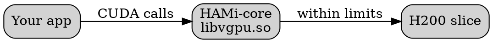
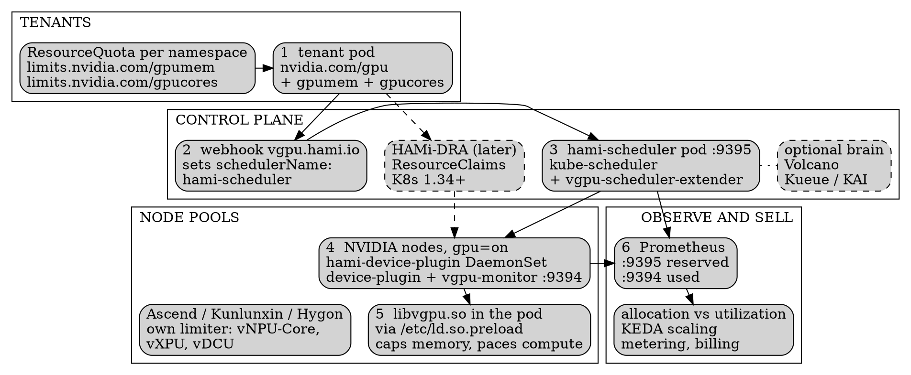

<!--
25 min talk, ContainerDays 2026 Singapore, Tuesday Oct 27. Story deck: start from one wasted H200, then walk through what a neocloud sells and what each product needs from the GPU layer. Each product adds one mechanism; the CNCF case studies then show it is not just our card, and where it stops working.
Timing: hook, why and what HAMi is (6.5 min), what a neocloud sells, fractional GPUs, notebooks, inference (6 min), batch, mixed fleet, DRA, sell (6.25 min), operate, generalise, limits, blueprint (4.75 min), community and close (1.25 min). About 25 min.
Sources: research/containerdays-sg-2026/case-studies.md (11 CNCF case studies, cncf.io/case-studies, project HAMi) and our own H200 measurements from the Viettel Cloud work.
30 s. Open: 'Raise your hand if you run GPUs on Kubernetes. Keep it up if you know your average utilization.' Then: this talk starts with one card and ends with a cloud. No vendor pitch: I will show where it does not work too.
-->
@variant dark
@side-image assets/qr-hami-repo.png
@kicker ContainerDays 2026 Singapore · CNCF Incubating project

# 10x Your Neocloud's GPU Utilization with HAMi

@subtitle What a neocloud sells, and what each product needs from the GPU

@speaker name="Reza Jelveh" role="Head of Global Market, Dynamia" github=github.com/fishman linkedin=linkedin.com/in/rezajelveh

---

<!--
1 min. Our own measurement (Viettel Cloud work). Two real jobs, each held a WHOLE H200 (141 GB).
1) Time-series forecast, small model: 1 GB of 141 GB, SM 16-18%.
2) YOLO11 defect-detection training, about 17k images: 39 GB. Batch is sized for accuracy, not to fill the card, so the ~100 GB left over is genuinely free.
Don't rush '1 GB out of 141'. Pause.
Kubernetes gives one choice: nvidia.com/gpu: 1. That is how a 1 GB job gets 141 GB.
-->

## One job, 1 GB of a 141 GB H200

@subtitle Allocated is not used

```seaborn
import matplotlib.pyplot as plt
plt.rcParams["font.sans-serif"] = [*plt.rcParams["font.sans-serif"], "DejaVu Sans"]

fg = plt.rcParams["text.color"]
dim = plt.rcParams["xtick.color"]
red = plt.rcParams["patch.edgecolor"]
cmap = plt.get_cmap("Paired")
yellow = cmap(6.5 / 12)
grey = "#dfe2ec"
plt.rcParams["patch.force_edgecolor"] = False

fig, ax = plt.subplots(figsize=(12.5, 3.4))
ax.set_facecolor("none")
fig.patch.set_alpha(0)

ax.text(-40, 1.75, "GPU MEMORY: ALLOCATED VS USED", fontsize=11.5, color=dim, family="monospace")
ax.barh(1, 141, color=grey, height=0.5)
ax.barh(1, 1, color=red, height=0.5)
ax.barh(0, 141, color=grey, height=0.5)
ax.barh(0, 39, color=yellow, height=0.5)

ax.text(-4, 1, "Time-series\n(inference)", ha="right", va="center", fontsize=14, color=fg, fontweight="bold", linespacing=1.4)
ax.text(-4, 0, "Defect detection\n(training)", ha="right", va="center", fontsize=14, color=fg, fontweight="bold", linespacing=1.4)
ax.text(6, 1, "1 GB used, SM 16-18%", ha="left", va="center", fontsize=14, color=fg, fontweight="bold")
ax.text(44, 0, "39 GB used", ha="left", va="center", fontsize=14, color=fg)
ax.text(141, 1.42, "one whole H200 = 141 GB", ha="right", va="bottom", fontsize=12, color=dim)

ax.annotate("", xy=(139, -0.55), xytext=(41, -0.55),
            arrowprops=dict(arrowstyle="<->", color=dim, linewidth=1.4))
ax.text(90, -0.74, "~100 GB free: inference, notebooks, CV, embedding",
        ha="center", va="top", fontsize=13, color=fg, fontweight="bold")

ax.set_xlim(-40, 148)
ax.set_ylim(-1.15, 1.95)
ax.spines[["top", "right", "left", "bottom"]].set_visible(False)
ax.tick_params(left=False, bottom=False, labelleft=False, labelbottom=False)
ax.grid(False)
```

- The time-series job leaves **140 GB and over 80% of the SMs** doing nothing
- Many cards have **no MIG** at all: L40, L40S, A6000

> Kubernetes gives one choice: `nvidia.com/gpu: 1`. The whole card, or nothing.

---

<!--
1 min. Is it just us? No. Seven independent measurements, before any sharing:
- NIO (autonomous driving), CI/testing on full GPUs: 5-10%. CI is mostly CPU: compile, fetch, preprocess.
- PREP EDU (Vietnam, EdTech, consumer RTX cards): 10-20% with static allocation.
- CETC Cloud: an embedding model held a whole 64 GB card and used 8 GB: 12.5% of VRAM. That one is memory, not SM.
- Ke Holdings: 13% across the whole platform, thousands of GPUs.
- Zhuoyu: dev environments and small inference below 15%. Only an upper bound, so the bar is hatched.
- Sangfor: small models 15-20%, one card one model.
- Our H200 from the last slide: SM 16-18%.
I did not average anything; ranges stay ranges.
Line to land: nobody here has a capacity problem. They have an allocation problem. A neocloud that rents whole cards sells this waste to its customers, or eats it.
-->

## Seven teams measured the same 5-20%

@subtitle Whole-card utilization before sharing, as each one reported it

```seaborn
import matplotlib.pyplot as plt
plt.rcParams["font.sans-serif"] = [*plt.rcParams["font.sans-serif"], "DejaVu Sans"]

fg = plt.rcParams["text.color"]
dim = plt.rcParams["xtick.color"]
cmap = plt.get_cmap("Paired")
used = cmap(5.5 / 12)
used_l = cmap(4.5 / 12)
track = "#e5e7eb"
plt.rcParams["patch.force_edgecolor"] = False

fig, ax = plt.subplots(figsize=(11.4, 4.3))
fig.subplots_adjust(left=0.005, right=0.995, top=0.995, bottom=0.005)
ax.set_facecolor("none")
fig.patch.set_alpha(0)

rows = [
    ("NIO", "CI / testing", 5, 10, "5-10%", "range"),
    ("PREP EDU", "inference, RTX 4070/4090", 10, 20, "10-20%", "range"),
    ("CETC Cloud", "embedding model, VRAM", 12.5, 12.5, "12.5%", "point"),
    ("Ke Holdings", "whole platform", 13, 13, "13%", "point"),
    ("Zhuoyu", "dev envs, small inference", 0, 15, "<15%", "upper"),
    ("Sangfor", "small models", 15, 20, "15-20%", "range"),
    ("Own H200", "time-series inference, SM", 16, 18, "16-18%", "range"),
]
n = len(rows)
for i, (org, what, lo, hi, txt, kind) in enumerate(rows):
    y = n - 1 - i
    ax.barh(y, 100, color=track, height=0.66, zorder=1)
    if kind == "upper":
        ax.barh(y, hi, color=used_l, height=0.66, hatch="///", edgecolor=used, linewidth=0, zorder=2)
    else:
        ax.barh(y, lo, color=used, height=0.66, zorder=2)
        if hi > lo:
            ax.barh(y, hi - lo, left=lo, color=used_l, height=0.66, zorder=2)
    ax.text(hi + 1.5, y, txt, ha="left", va="center", fontsize=14, color=fg, fontweight="bold", zorder=3)
    ax.text(33.5, y, what, ha="left", va="center", fontsize=12, color=dim, zorder=3)
    ax.text(-1.5, y, org, ha="right", va="center", fontsize=14, color=fg, fontweight="bold")

ax.text(100, n - 0.5, "one whole card = 100%", ha="right", va="bottom", fontsize=12, color=dim)
ax.text(-19, n - 0.5, "SOLID = LOW END   LIGHT = REPORTED RANGE   HATCHED = UPPER BOUND ONLY",
        ha="left", va="bottom", fontsize=10, color=dim, family="monospace")
ax.set_xlim(-19, 100.5)
ax.set_ylim(-0.5, n + 0.1)
ax.spines[["top", "right", "left", "bottom"]].set_visible(False)
ax.tick_params(left=False, bottom=False, labelleft=False, labelbottom=False)
ax.set_xticks([])
ax.grid(False)
```

Different industries, chips and countries. Most of every card: paid for and idle.

---

<!--
1 min. Promise 1: why DRA alone does not fix utilization.
Device plugin: nvidia.com/gpu: 1 is an integer. The whole card or nothing. That is how the 1 GB job got 141 GB.
DRA is a real improvement. ResourceClaims against ResourceSlices can ask for part of a device, with typed capacities: this much memory, this share of compute. That is the request API.
But a claim is a promise on paper. It does not stop a pod at 8 GB, it does not cap compute, and the default scheduler has no notion of packing shares on one card.
You need two more things: virtualization on the node that caps each slice's memory and compute, and a scheduler that knows how to share. The rest of the talk adds exactly those, one neocloud product at a time.
Sangfor said it best in their CNCF case study (quote on slide). That pair, virtualization plus a sharing scheduler, is what HAMi is.
-->

@layout compare

## Why DRA alone can't fix it

@subtitle Asking for part of a GPU doesn't stop a job using all of it

::: card {tag=red}
### {icon:box cls=accent-secondary} Device plugin
`nvidia.com/gpu: 1` is an integer: the whole card or nothing. The 1 GB job gets 141 GB.
:::

::: arrow
{icon:arrow-right size=32}
:::

::: card {tag=yellow}
### {icon:file-text cls=accent-contrast} DRA alone
- **Request:** a claim can ask for MiB and %
- **Limit:** nothing stops the pod using more memory or compute
- **Pack:** nothing places shares onto one card
:::

::: notes {tag=green}
"GPU sharing without smart scheduling leads to suboptimal placement; scheduling without GPU virtualization leaves nothing to schedule." Sangfor
:::

---

## What is HAMi

@subtitle Static allocation, one GPU per task

<!--
0.5 min. GPUs are expensive and mostly idle. HAMi is a CNCF Incubating project for heterogeneous GPU sharing on Kubernetes. Without it, Kubernetes hands every task a whole card, however little it uses.
-->


---

## What is HAMi
@transition none

@subtitle Fractional vGPUs, multiple tasks per device

<!--
0.5 min. With HAMi, each task asks for a slice: memory in MiB, compute in percent. Several tasks share one device, each held to its own slice. No code changes, no driver changes.
-->


---

## HAMi Capabilities

@subtitle Six things HAMi brings to GPU scheduling

<!--
1 min. Six capabilities. For a neocloud the important ones: heterogeneous management (one pool, whatever hardware arrives), memory and compute limits per slice, and scheduling policy. Kubernetes native means DRA and CDI too: we come back to DRA later.
-->

::: grid {cols=2}
::: card
### {icon:layers cls=accent-primary} Heterogeneous Management

Manage GPU, NPU, MLU, and other accelerators in one workflow.
:::
::: card
### {icon:shield-check cls=accent-primary} Hard Isolation

Slice memory and compute with hard isolation at runtime.
:::
::: card
### {icon:git-branch cls=accent-contrast} Advanced Scheduling

Binpack, spread, and topology-aware placement policies.
:::
::: card
### {icon:box cls=accent-primary} Kubernetes Native

Kubernetes-native APIs, DRA, and CDI support.
:::
::: card
### {icon:gauge cls=accent-primary} Resource Isolation & QoS

Memory and core quotas for fair, stable sharing.
:::
::: card
### {icon:chart-bar cls=accent-contrast} Unified Monitoring

Consistent metrics and visibility across vendors.
:::
:::

---

<!--
1 min. What is a neocloud? A GPU-first cloud provider: it rents accelerated compute and the software layer on top to AI teams, with multi-tenant isolation, usage-based billing and an API or console, as an alternative to the hyperscalers.
This is the map for the next 15 minutes. Each product on the slide needs something different from the GPU layer:
- GPU capacity, whole or fractional: device sharing and partitioning, topology-aware scheduling.
- Dev environments and notebooks: isolation between co-located users, per-user limits, idle reclaim.
- Inference endpoints: GPU-memory-aware packing, autoscaling, per-endpoint quotas.
- Model APIs, sold per token: many models packed per GPU, request-level metering.
- Batch and training jobs: queueing, fair share, gang scheduling, priorities, per-tenant quotas. Training usually stays on whole cards.
- Under all of them: tenants, quotas, metering, billing, console and API, observability. That needs tenant-scoped limits and accurate per-GPU usage records.
Templates and one-click presets sit on top and need to know which hardware fits; I will not cover them.
Two things cut across every product and get their own stop: the second card in the rack is often not NVIDIA, and the request API is moving to DRA.
-->

## What a neocloud sells

@subtitle A GPU-first cloud: each product needs something different from the GPU

::: grid {cols=3}
::: card {tag=cyan}
### {icon:cpu cls=accent-primary} GPU capacity
Whole or fractional: sharing, topology-aware placement
:::
::: card {tag=cyan}
### {icon:notebook-pen cls=accent-primary} Notebooks, dev envs
Isolation between users, per-user limits, idle reclaim
:::
::: card {tag=green}
### {icon:zap cls=accent-primary} Inference
Endpoints and model APIs: memory-aware packing, autoscaling
:::
::: card {tag=green}
### {icon:list-ordered cls=accent-primary} Batch and training
Queues, fair share, gang scheduling, priorities
:::
::: card {tag=yellow}
### {icon:layers cls=accent-contrast} Mixed fleet
Any vendor underneath, one request API
:::
::: card {tag=red}
### {icon:receipt cls=accent-secondary} Tenants and billing
Quotas, metering, accurate per-GPU usage records
:::
:::

---

<!--
1.5 min. Promise 2: how vGPU interception holds each pod to its memory and compute limits.
1. The pod asks for memory in MiB and compute in percent of SMs, next to nvidia.com/gpu: 1.
2. HAMi's scheduler extender picks a physical card UUID with enough headroom and writes it on the pod.
3. The device plugin's Allocate mounts HAMi-core, libvgpu.so, and writes it into /etc/ld.so.preload, so the dynamic linker loads it before the app. It sits in front of the CUDA driver API.
4. Memory: every allocation is checked against the slice in MiB. Over the limit means OOM inside this pod; the neighbours keep running. Compute: a token bucket meters kernel launches so the pod averages its percent of the SMs, 1% granularity.
5. nvidia-smi inside the pod shows the slice, not the card: 15000 MiB, not 141 GB. Frameworks that size themselves from free memory behave.
No kernel module, no driver change, no image change: SF Technology reports zero changes to driver, kernel, image or source.
This is product one, fractional GPU capacity: the slice is the unit you rent. Same pattern per vendor where there is a hook point. Live demo of this is in the workshop at 12:30.
-->

@layout two-col

## Fractional GPUs: split the card

@subtitle How vGPU interception caps memory and compute

1. Pod asks for **MiB** of memory and **%** of compute
2. Scheduler picks a card **UUID** with headroom
3. Device plugin injects **`libvgpu.so`** via `ld.so.preload`
4. HAMi-core intercepts CUDA: allocations capped at the slice, launches paced by a **% token bucket**
5. `nvidia-smi` in the pod shows **the slice, not the card**

@col

```yaml
resources:
  limits:
    nvidia.com/gpu: 1
    nvidia.com/gpumem: 15000   # MiB
    nvidia.com/gpucores: 30    # % of SMs
```

::: card {blueprint}

:::

---

<!--
1 min. Left: the measured split of our H200. The training notebook (YOLO11) gets a 39 GB slice, the time-series job a 1 GB slice, about 100 GB is free for the next tenants. Memory is the hard constraint: an OOM cannot wait (NIO says the same in their case study), so memory is fenced, never over-committed by default.
Right: compute is different. Illustration, not a measurement: a pod at 25% of the SMs is paced on every kernel launch and cannot burst above its share even if the rest is idle. A compute shortage can be absorbed as delay, a memory shortage cannot.
-->

## Fractional GPUs: two fences on one card

@subtitle Memory is a hard wall, compute is a pace

::: grid {cols=2}
::: card
### {icon:memory-stick cls=accent-primary} Memory: MiB slices
```seaborn
import matplotlib.pyplot as plt
plt.rcParams["font.sans-serif"] = [*plt.rcParams["font.sans-serif"], "DejaVu Sans"]

fg = plt.rcParams["text.color"]
dim = plt.rcParams["xtick.color"]
accent = plt.rcParams["axes.edgecolor"]
red = plt.rcParams["patch.edgecolor"]
grey = "#dfe2ec"
plt.rcParams["patch.force_edgecolor"] = False

fig, ax = plt.subplots(figsize=(6.2, 2.9))
ax.set_facecolor("none")
fig.patch.set_alpha(0)
ax.text(0, 1.62, "MEMORY: ONE H200, 141 GB", fontsize=11, color=dim, family="monospace")
segs = [(39, accent, "39 GB"), (1, red, ""), (101, grey, "~100 GB free")]
left = 0
for w, c, t in segs:
    ax.barh(1, w, left=left, color=c, height=0.7, edgecolor="white", linewidth=1.5)
    if t:
        ax.text(left + w / 2, 1, t, ha="center", va="center", fontsize=12,
                color="white" if c == accent else fg, fontweight="bold")
    left += w
ax.text(19.5, 0.42, "notebook\n(training)", ha="center", va="top", fontsize=11, color=fg, linespacing=1.3)
ax.text(40, 0.42, "time-series\n1 GB", ha="left", va="top", fontsize=11, color=red, fontweight="bold", linespacing=1.3)
ax.text(141, 0.42, "next tenants", ha="right", va="top", fontsize=11, color=dim)
ax.set_xlim(-1, 142)
ax.set_ylim(-0.35, 1.85)
ax.spines[["top", "right", "left", "bottom"]].set_visible(False)
ax.tick_params(left=False, bottom=False, labelleft=False, labelbottom=False)
ax.grid(False)
```
:::
::: card
### {icon:gauge cls=accent-primary} Compute: paced on every launch
```seaborn
import matplotlib.pyplot as plt
plt.rcParams["font.sans-serif"] = [*plt.rcParams["font.sans-serif"], "DejaVu Sans"]

fg = plt.rcParams["text.color"]
dim = plt.rcParams["xtick.color"]
cmap = plt.get_cmap("Paired")
green = cmap(3.5 / 12)
grey = "#dfe2ec"
plt.rcParams["patch.force_edgecolor"] = False

fig, ax = plt.subplots(figsize=(6.2, 2.9))
ax.set_facecolor("none")
fig.patch.set_alpha(0)
units, assigned = 8, 2
ax.bar(range(units), [1] * units, width=0.85,
       color=[green] * assigned + [grey] * (units - assigned), edgecolor="white", linewidth=1.5)
ax.annotate("", xy=(-0.4, -0.3), xytext=(1.4, -0.3),
            arrowprops=dict(arrowstyle="<->", color=fg, linewidth=1.4))
ax.text(0.5, -0.45, "pod A: 25%", ha="center", va="top", fontsize=12, color=fg, fontweight="bold")
ax.text(4.5, -0.45, "75% free for other pods", ha="center", va="top", fontsize=12, color=fg, fontweight="bold")
ax.text(-0.5, 1.25, "COMPUTE: % OF SMs (ILLUSTRATIVE)", fontsize=11, color=dim, family="monospace")
ax.set_xlim(-0.6, 7.6)
ax.set_ylim(-0.9, 1.5)
ax.spines[["top", "right", "left", "bottom"]].set_visible(False)
ax.tick_params(left=False, bottom=False, labelleft=False, labelbottom=False)
ax.grid(False)
```
:::
:::

- **Memory is the hard wall:** an OOM cannot wait, so it stays inside the slice
- **Compute is a pace:** a shortage becomes delay, no burst above the share

---

<!--
1.5 min. Notebooks and dev environments, and promise 6, part 1: overhead expectations. A notebook product needs isolation between co-located users and per-user limits; a limit you can rely on has a price. Ours first, then three case studies.
Our H200: capping the training notebook to 70% of the cores turned a 1h00 run into 1h20. +20 minutes, paid on purpose: the freed share is reserved, not 'maybe free'. Small model; a big model pays more.
CETC Cloud: embedding model moved from a whole 64 GB card to 8 GB and 20% compute. Token throughput within 5% of the whole-card run, p95 latency and model load time essentially identical.
CMB: ResNet50 inference, batch 32: one card went from 64.6 to 94.8 images/s (+46.7%) with finer partitioning, because more work runs concurrently. Per card, not per job.
NIO: about 1/6 of a GPU was optimal for simulation; at 1/8 scheduling and virtualization overhead lowered throughput. NIO also says plainly that HAMi has some overhead compared to a full card.
Honest caveat: the cap isolates stability, not throughput. Shared with bursty inference, epoch-time jitter went from 19% uncapped to 9% capped (backup slide). For hard throughput isolation use MIG.
-->

## Notebooks: the price of a guaranteed slice

@subtitle Per-user limits cost something: overhead as measured, ours and theirs

::: card {metric}
+20 min
1 h training run capped to 70% cores (own H200)
:::

::: card {metric}
within 5%
throughput on 8 GB, 20% compute (CETC)
:::

::: card {metric}
+46.7%
card throughput, partitioned (CMB)
:::

::: card {metric}
1/6 GPU
beat 1/8: finer is not better (NIO)
:::

- {icon:lock cls=accent-primary} **+20 min** buys a reserved share, not a "maybe free" one
- {icon:memory-stick cls=accent-primary} **Size memory first:** an OOM cannot wait, a compute shortage becomes delay (NIO)
- {icon:triangle-alert cls=accent-secondary} The cap protects **stability, not throughput**: hard throughput isolation is MIG

---

<!--
1.5 min. Inference endpoints and model APIs: pack replicas by GPU memory and autoscale them. Our own measurement on the H200, time-series inference service, p95 held at 160 ms.
Native: one pod per card, 20.7 req/s, SM 18%. With HAMi slices plus KEDA scaling to 10 replicas on the same card: 71.1 req/s at the same p95. SM goes 18, 31, 54, 100% at 1, 2, 5, 10 replicas.
Land it: HAMi does not make one pod faster. It fills the card that was sitting empty. For model APIs sold per token the same move is many models per card: Sangfor went from 1 to 8+ models per GPU.
The team challenged the baseline: raising the batch size from 32 to 512 left the GPU at 7-10%; one instance simply cannot fill an H200. This is the time-series service from the 1 GB job, a Chronos forecaster of about 200M parameters predicting infrastructure load (same 18% SM; kcd_vietnam.md:688,752), so a batch is a group of forecast requests per inference call. The source records only "batch->512", so say it that way if asked.
Cost framing (example only): the same 71 req/s natively needs about 3.4 cards, so roughly 71% fewer cards, about 51% less power, ~$7k/month at an example $4/GPU-hour.
-->

## Inference and model APIs: 1 to 10 replicas

@subtitle Fix the SLA, pack replicas by memory, autoscale, fill the empty card

```seaborn
import matplotlib.pyplot as plt
plt.rcParams["font.sans-serif"] = [*plt.rcParams["font.sans-serif"], "DejaVu Sans"]

fg = plt.rcParams["text.color"]
dim = plt.rcParams["xtick.color"]
accent = plt.rcParams["axes.edgecolor"]
red = plt.rcParams["patch.edgecolor"]
cmap = plt.get_cmap("Paired")
green = cmap(3.5 / 12)
grey = "#c9cddb"
plt.rcParams["patch.force_edgecolor"] = False

fig, (ax1, ax2) = plt.subplots(1, 2, figsize=(12, 3.3),
                               gridspec_kw={"width_ratios": [1.3, 1], "wspace": 0.32})
fig.patch.set_alpha(0)
for ax in (ax1, ax2):
    ax.set_facecolor("none")
    ax.spines[["top", "right", "left", "bottom"]].set_visible(False)
    ax.tick_params(left=False, labelleft=False, bottom=False, labelbottom=False)
    ax.grid(False)

ax1.text(-42, 3.35, "REQ/S PER CARD @ P95 160 MS", fontsize=10.5, color=dim, family="monospace")
for y, v, n, c in [(2, 20.7, "Native", grey), (0, 71.1, "HAMi + KEDA", red)]:
    ax1.barh(y, v, color=c, height=0.62)
    ax1.text(-3, y, n, ha="right", va="center", fontsize=12, color=fg, fontweight="bold")
    ax1.text(v + 3, y, str(v), ha="left", va="center", fontsize=12.5, color=fg, fontweight="bold")
ax1.plot([20.7, 20.7], [-0.5, 2.5], color=dim, linewidth=1.2, linestyle=(0, (4, 3)))
ax1.text(20.7, 2.55, "one whole GPU", ha="center", va="bottom", fontsize=10.5, color=dim)
ax1.text(-3, -0.6, "3.4x per card", ha="right", va="center", fontsize=11.5, color=red, fontweight="bold")
ax1.set_xlim(-42, 100)
ax1.set_ylim(-0.9, 3.6)

ax2.text(-0.15, 128, "SM UTILIZATION VS REPLICAS", fontsize=10.5, color=dim, family="monospace")
xs, vals = [0, 1, 2, 3], [18, 31, 54, 100]
ax2.plot(xs, vals, color=red, linewidth=2.2, zorder=2)
for x, v, c, r in zip(xs, vals, [grey, red, red, green], [7, 5.5, 5.5, 9]):
    ax2.plot(x, v, "o", markersize=r, color=c, markeredgecolor="white", markeredgewidth=1.3, zorder=3)
    ax2.text(x, v + 8, f"{v}%", ha="center", fontsize=11.5, color=fg, fontweight="bold")
for x, lab in zip(xs, ["1", "2", "5", "10 replicas"]):
    ax2.text(x, -13, lab, ha="center", fontsize=12, color=dim)
ax2.set_xlim(-0.35, 3.4)
ax2.set_ylim(-22, 140)
```

- One pod uses **18%** of the SMs. Ten replicas on the same card: **100%, same p95**
- HAMi does not make one pod faster: **it fills the card that sat empty**
- Bigger batches did not help: **32 to 512** forecast requests per call, GPU still at 7-10%
- Model APIs, same move: **many models per card** (Sangfor: 1 to 8+ per GPU)

---

<!--
1.5 min. Batch and training jobs, and promise 3 (the scheduler). Continued on the mixed-fleet slide.
The chart is our design for one AI notebook card: three load mixes on the same H200. The notebook keeps its ~30% memory slice in every mix, never moves. When forecasts are busy, time-series runs x6. When LLM traffic is busy, time-series drops to x1 and the space goes to LLM inference x5 (models under 20B). When inference is quiet, the space goes to more notebooks and batch training.
Capacity model: every card reports its memory, cores and share count onto the node, and the scheduler extender fits per card, not per node. A pod that needs 45 GB stays pending on a node with two 40 GB cards, even though the node total fits.
Placement: binpack or spread on two axes, which node and which card. Binpack small tenants so whole cards stay free for whole-card customers and big training; spread for fewer noisy neighbours. Topology (NVLink, PCIe, NUMA) is part of the card choice.
Hand-off: KEDA scales the replicas, so freed capacity moves to whoever peaks next. They peak at different times, so they take turns on one card.
Batch needs queues, fair share, gang scheduling, priorities and per-tenant quotas. HAMi does not do that itself: it is a capacity model plus extender, and the isolation library. Bring your own brain: Sangfor runs Volcano for gang scheduling, Zhuoyu Koordinator, CMB Kueue for training admission and quota; KAI Scheduler's resource isolator ships the same libvgpu.so. You do not have to replace the scheduler you have (backup slide).
-->

## Batch and training: the scheduler decides

@subtitle Notebooks, inference and training share one card; placement and queues decide who gets it

```seaborn
import matplotlib.pyplot as plt
plt.rcParams["font.sans-serif"] = [*plt.rcParams["font.sans-serif"], "DejaVu Sans"]

fg = plt.rcParams["text.color"]
dim = plt.rcParams["xtick.color"]
accent = plt.rcParams["axes.edgecolor"]
cmap = plt.get_cmap("Paired")
red = cmap(5.5 / 12)
orange = cmap(6.5 / 12)
bluel = cmap(0.5 / 12)
grey = "#dfe2ec"
plt.rcParams["patch.force_edgecolor"] = False

fig, ax = plt.subplots(figsize=(12.5, 3.6))
fig.patch.set_alpha(0)
ax.set_facecolor("none")
ax.spines[["top", "right", "left", "bottom"]].set_visible(False)
ax.tick_params(left=False, bottom=False, labelleft=False, labelbottom=False)
ax.grid(False)

ax.text(-33, 2.86, "ONE H200, THREE LOAD MIXES", fontsize=11.5, color=dim, family="monospace")
rows = [
    (2, "Forecasts busy", [(30, accent, "Notebook ~30%"), (50, red, "Time-series x6"), (20, grey, "")]),
    (1, "LLM traffic busy", [(30, accent, "Notebook ~30%"), (8, red, "x1"), (42, orange, "LLM inference x5"), (20, grey, "")]),
    (0, "Inference quiet", [(30, accent, "Notebook ~30%"), (42, bluel, "batch training"), (8, red, "x1"), (20, grey, "")]),
]
for y, label, segs in rows:
    left = 0
    for w, c, txt in segs:
        ax.barh(y, w, left=left, color=c, height=0.62, edgecolor="white", linewidth=1.8)
        if txt:
            ax.text(left + w / 2, y, txt, ha="center", va="center", fontsize=11,
                    color=fg if c in (orange, bluel) else "white", fontweight="bold")
        left += w
    ax.text(-3, y, label, ha="right", va="center", fontsize=13, color=fg, fontweight="bold")
ax.text(100, 2.7, "card full", ha="right", va="bottom", fontsize=10, color=dim)
ax.plot([100, 100], [-0.4, 2.58], color=dim, linewidth=1.0, linestyle=(0, (2, 3)), zorder=1)
ax.set_xlim(-33, 106)
ax.set_ylim(-0.6, 3.2)
```

- {icon:layout-grid cls=accent-primary} **Placement:** per-card capacity, binpack or spread per node and per card, topology-aware
- {icon:refresh-cw cls=accent-secondary} **Hand-off:** KEDA scales replicas, so freed slices go to whoever peaks next
- {icon:brain cls=accent-primary} **Queues, gang, fair share:** your brain on the same fences: Volcano, Kueue, Koordinator, KAI

---

<!--
1 min. Promise 6, part 2: best-fit workloads, and why a neocloud's training product usually rents whole cards. The most useful table for an operator.
Whole card for large training (Ke, CMB, NIO, CETC) and large LLM serving (CETC keeps 4 GPUs exclusive for text generation; Ke keeps H200/H100 for big LLMs on a separate cluster).
HAMi slices for small and bursty inference (Ke typically 1-2 GB VRAM per service, Sangfor, DaoCloud, SF, PREP EDU, NIO), dev environments and notebooks (CETC, Zhuoyu Codespaces, our Viettel notebook), CI and testing (NIO, SF test cluster), embedding and rerank (CETC).
NIO runs all three: MIG for algorithm development where they want strong isolation, HAMi for CI, simulation and some inference, time-slicing for contention-tolerant work. That is not a vendor choice, it is a workload choice.
CETC's lesson: start from workload profiles, not a preset partition ratio.
-->

## What production users don't share

@subtitle Share small, bursty, interactive. Keep big training whole.

| Workload | How it runs | Who |
| --- | --- | --- |
| Large training, large LLM serving | **Whole card** | Ke, CMB, NIO, CETC |
| Small or bursty inference | **HAMi slice** | Ke, Sangfor, DaoCloud, SF, PREP EDU, NIO |
| Dev envs, notebooks, CI | **HAMi slice** (MIG for hard isolation) | CETC, Zhuoyu, NIO, SF, own |
| Embedding, rerank, simulation | **HAMi slice** | CETC, NIO |

::: notes {tag=green}
Profile workloads first, not a preset ratio (CETC).
:::

---

<!--
1.5 min. Promises 3 and 7: heterogeneous scheduling, every vendor's accelerators as first-class citizens. Every neocloud product sits on whatever hardware the supply chain delivers.
The API stays one shape (memory + cores per vendor resource name); what stops a pod using more underneath depends on what the chip gives you:
- NVIDIA and Ascend have no hardware compute cap, so HAMi intercepts in user space (token bucket, 1%). CMB built vNPU-core for Ascend the same way: 1 GB memory, 1% compute.
- AMD CU masking and NVIDIA MPS are caps the hardware scheduler honours, static per process.
- Kunlunxin vXPU, Hygon vDCU and MIG are hardware-fenced: coarse, but the silicon itself stops a pod going past its partition.
- Vendors with no hook point and no quota API (DeepX, Axelera today): the scheduler can only count what it reserved; nothing on the chip stops a pod using more, and no compute slicing without reverse engineering. Honest boundary.
For a neocloud: the SKU you sell is the same, the guarantee behind it is not. Know which row each of your chips is in.
China Merchants Bank (CNCF case study, ~10,000 cards): Kunlunxin, several Ascend models, NVIDIA, PPUs, Moore Threads, MetaX. Without HAMi every hardware delivery would have been its own cluster: 8+ clusters, each with its own device plugin, scheduler policy, monitoring, runbooks. Their supernodes use dual-chip modules; odd-card allocation caused driver errors. Paired allocation inside a module made 100% of the pool usable; three-tier network scoring (same node, same LEAF, cross LEAF) cut cross-machine scheduling by 30%.
DaoCloud calls non-NVIDIA accelerators 'first-class citizens' on D.run. CETC's supported list: NVIDIA, Ascend, Cambricon, Hygon, Iluvatar CoreX, Moore Threads, MetaX, Enflame, Kunlunxin, AWS Neuron, Vastai.
-->

@layout two-col

## Mixed fleet: the second card isn't NVIDIA

@subtitle Every vendor's chips first-class: one pool, one API, a different limiter per vendor

| Hardware | Compute cap |
| --- | --- |
| NVIDIA, Ascend | User-space interception, 1% token bucket |
| AMD CU masking, NVIDIA MPS | Hardware-honoured, static |
| Kunlunxin vXPU, Hygon vDCU, MIG | Hardware-fenced, coarse |
| DeepX, Axelera | No hook point today |

```yaml
nvidia.com/gpucores: 30          # same shape,
huawei.com/Ascend910C-core: 20   # any vendor
```

@col

::: card {tag=green}
### {icon:merge cls=accent-primary} 8+ clusters avoided
China Merchants Bank: Kunlunxin, Ascend, NVIDIA, PPU, Moore Threads, MetaX in **one pool**
:::

::: card {tag=cyan}
### {icon:network cls=accent-primary} Topology counts
Paired allocation on supernodes: **100% of the pool usable**, cross-machine scheduling **-30%** (CMB)
:::

---

<!--
1.5 min. Promise 4: how DRA fits, and where it falls short.
Fits: HAMi-DRA (github.com/Project-HAMi/HAMi-DRA) is a mutating webhook that rewrites nvidia.com/gpu, gpumem, gpucores requests into DRA ResourceClaims. Kubernetes 1.34+ with the DRA Consumable Capacity feature gate and CDI in the runtime. Since HAMi v2.8 the same semantics exist on the DRA path: typed capacities in ResourceSlices (memory step 1 MiB, cores 0-100). A ResourceClaimTemplate mode exists for Kueue admission. Your pod YAML does not change.
Falls short today:
- DRA reserves the slice, but on its own nothing stops the pod using more of the card. HAMi-core (or the vendor mechanism from the mixed-fleet slide) is what holds it to the slice.
- Claims are accounting: they tell you what was reserved, not what is used.
- None of the 11 CNCF case studies runs DRA in production; Sangfor lists joining the HAMi DRA ecosystem as future work.
My advice to a neocloud today: build on the device plugin path, keep the Pod API stable, move to DRA underneath when your Kubernetes version and your schedulers are ready. Users will not notice.
-->

@layout compare

## Requests: where DRA fits, and falls short

@subtitle The request changes; what caps the pod on the card doesn't

::: card {tag=green}
### {icon:check cls=accent-primary} What DRA gives
- **HAMi-DRA** webhook rewrites `nvidia.com/gpu` into **ResourceClaims**
- K8s **1.34+**, Consumable Capacity gate + CDI
- Typed capacities: MiB, % cores
:::

::: arrow
{icon:arrow-right size=32}
:::

::: card {tag=red}
### {icon:triangle-alert cls=accent-secondary} Where it falls short
- **Reserves** a slice, but nothing on the card **stops the pod using more**
- Shows what was **reserved**, not what is **used**
- No CNCF case study runs it in production yet
:::

::: notes {tag=green}
Keep the Pod API stable now, move to DRA underneath when your Kubernetes and scheduler are ready.
:::

---

<!--
1.25 min. Promises 5 and 8: production patterns from cloud providers running 10,000+ GPUs, and the cross-cutting layer every neocloud product needs: tenants, quotas, metering, billing.
DaoCloud CNCF case study (Dec 2025): HAMi active on 10,000+ GPU cards, DaoCloud-operated plus customer-owned. D.run is their public GPU cloud: 7 active regions, 10+ data centers, single regions up to ~3,000 GPUs. DCE is their private platform for enterprises.
From card to SKU, as they describe it:
1. Define the unit: a vGPU slice with fixed memory and compute. That is the split from the fractional-GPU slides.
2. Package slices as standardized SKUs in a central marketplace. Users pay by workload size, not by full card. A 7B inference endpoint does not need an H100; it needs a slice.
3. Fill: controlled over-subscription. Not every tenant peaks at once, so you sell slightly more than the physical card, with the scheduler watching.
4. Govern: on DCE, quotas and RBAC at vGPU level, per department and queue. NVIDIA and other vendors' accelerators under one abstraction.
Results: >80% average utilization per card, 20-30% lower GPU-related opex. They give no before number, so I do not claim a multiplier for them. No SKU sizes or prices are published either, so I show none.
-->

## Sell and meter: the slice becomes the product

@subtitle DaoCloud D.run: the box became a cloud

::: card {metric}
10,000+
GPU cards under HAMi
:::

::: card {metric}
80%+
avg utilization per card
:::

::: card {metric}
20-30%
lower GPU opex
:::

How D.run turns cards into products:

::: grid {cols=4}
::: card {tag=cyan}
### {icon:scissors cls=accent-primary} 1. Define
vGPU unit: fixed memory + compute
:::
::: card {tag=green}
### {icon:tag cls=accent-primary} 2. Package
SKUs, pay by workload size
:::
::: card {tag=yellow}
### {icon:layers cls=accent-contrast} 3. Fill
Controlled over-subscription
:::
::: card {tag=red}
### {icon:users cls=accent-secondary} 4. Govern
Quotas + RBAC per vGPU, 7 regions
:::
:::

---

<!--
1 min. Promise 5, part 2: how production users operate it. For a neocloud this is metering: you bill from one number and plan capacity from the other. Quotas: one namespace per tenant with a standard ResourceQuota on limits.nvidia.com/gpumem and limits.nvidia.com/gpucores; HAMi tracks those keys since v2.7.0 (blueprint slide).
Measure: Zhuoyu publishes clean definitions. Allocation = scheduled cards / schedulable cards. Utilization = mean SM utilization from node telemetry. They hit >95% allocation and >55% utilization at the same time, ~60% on shared inference. If you only watch allocation you will think you are full while the silicon idles. HAMi exposes both: scheduler metrics on 9395 are reservations, vGPUmonitor on 9394 is usage. Price from one, plan capacity from the other.
Upgrade: NIO validates every HAMi version and upgrades inference device plugins blue-green.
Scale: SNOW Corp (Korea, 1,000+ A100s) scales on unacked messages / active consumers at about 0.7, so replicas are warm before the queue explodes (~60 s model warm-up). They handled a 700% viral spike and need 2x fewer GPUs for train plus inference pipelines. Honest attribution: SNOW credits most savings to KEDA; HAMi for sharing and avoiding a re-architecture.
-->

## Operate it: allocation is not utilization

@subtitle Quotas and metering need both numbers

::: grid {cols=4}
::: card {tag=cyan}
### {icon:chart-bar cls=accent-primary} Meter both
Bill from allocation (scheduler `:9395`), plan from usage (vGPUmonitor `:9394`).
:::
::: card {tag=red}
### {icon:users cls=accent-secondary} Tenant quotas
ResourceQuota on `gpumem` and `gpucores` per namespace.
:::
::: card {tag=green}
### {icon:refresh-cw cls=accent-primary} Upgrades
NIO: blue-green device plugin, phased rollout, perf checked per version.
:::
::: card {tag=yellow}
### {icon:trending-up cls=accent-contrast} Scale ahead
SNOW: KEDA scales on queue saturation. **700%** spike handled, **2x** fewer GPUs.
:::
:::

```seaborn
import matplotlib.pyplot as plt
plt.rcParams["font.sans-serif"] = [*plt.rcParams["font.sans-serif"], "DejaVu Sans"]

fg = plt.rcParams["text.color"]
dim = plt.rcParams["xtick.color"]
cmap = plt.get_cmap("Paired")
alloc, used, track = cmap(1.5 / 12), cmap(5.5 / 12), cmap(0.5 / 12)
plt.rcParams["patch.force_edgecolor"] = False

fig, ax = plt.subplots(figsize=(12, 2.1))
fig.patch.set_alpha(0)
ax.set_facecolor("none")
for y, v, c, name, sub, lab in [
    (1, 95, alloc, "Allocation", "scheduled / schedulable cards", ">95%"),
    (0, 55, used, "Utilization", "mean SM util, node telemetry", ">55%"),
]:
    ax.barh(y, 100, color=track, alpha=0.35, height=0.6)
    ax.barh(y, v, color=c, height=0.6)
    ax.text(-1.5, y + 0.03, name, ha="right", va="bottom", fontsize=12, color=fg, fontweight="bold")
    ax.text(-1.5, y + 0.01, sub, ha="right", va="top", fontsize=9, color=dim)
    ax.text(v - 1.5, y, lab, ha="right", va="center", fontsize=12, color="white", fontweight="bold")
ax.annotate("", xy=(95, -0.42), xytext=(55, -0.42), arrowprops=dict(arrowstyle="<->", color=dim, linewidth=1.3))
ax.text(75, -0.5, "reserved, not busy", ha="center", va="top", fontsize=10, color=fg, fontweight="bold")
ax.text(-30, 1.55, "ZHUOYU, SAME FLEET, TWO NUMBERS", fontsize=10, color=dim, family="monospace")
ax.set_xlim(-30, 101)
ax.set_ylim(-0.95, 1.75)
ax.spines[["top", "right", "left", "bottom"]].set_visible(False)
ax.tick_params(left=False, bottom=False, labelleft=False, labelbottom=False)
ax.grid(False)
```

---

<!--
1 min. Now the honest version of the title. Every number here is from a CNCF case study or our own measurement.
Per workload (red): CETC dev pods per device 2 to 30 (15x). NIO CI utilization 5% to 30-50%: up to 10x (their headline says 10x, the text says about 4x, so I say 'up to'). Sangfor models per GPU 1 to 8+. Our H200: 3.4x req/s per card.
Whole platform (blue): Sangfor GPU utilization >3x. Ke Holdings 13% to 37%. SNOW: 2x fewer GPUs for train + inference. China Merchants Bank 35% to 60%+ on ~10,000 cards; CMB warns the gain cannot be attributed to any single component.
10x is real where you start at 5-15%: CI, dev environments, notebooks, embedding, small inference. Whole platforms land at 2-3x because training already uses its cards. For a neocloud whose customers are mostly small inference and dev, your mix decides where you land. If someone promises 10x for your whole cloud, ask what your baseline is.
-->

## It's not just one H200

@subtitle 10x where the baseline is 5-15%, 2-3x platform-wide

```seaborn
import matplotlib.pyplot as plt
plt.rcParams["font.sans-serif"] = [*plt.rcParams["font.sans-serif"], "DejaVu Sans"]

fg = plt.rcParams["text.color"]
dim = plt.rcParams["xtick.color"]
accent = plt.rcParams["axes.edgecolor"]
red = plt.rcParams["patch.edgecolor"]
plt.rcParams["patch.force_edgecolor"] = False

per_workload = [
    ("CETC", "dev pods per device, 2 to 30", 15, "15x"),
    ("NIO", "CI GPU util, 5% to 30-50%", 10, "up to 10x"),
    ("Sangfor", "models per GPU, 1 to 8+", 8, "8x"),
    ("Own H200", "req/s per card at same p95", 3.4, "3.4x"),
]
platform = [
    ("Sangfor", "GPU utilization", 3, "3x+"),
    ("Ke Holdings", "platform util, 13% to 37%", 2.8, "2.8x"),
    ("SNOW", "GPUs for train + inference", 2, "2x"),
    ("CMB", "avg util, 35% to 60%+", 1.7, "1.7x"),
]
fig, axes = plt.subplots(1, 2, figsize=(13, 3.6), gridspec_kw={"wspace": 0.05})
fig.patch.set_alpha(0)
for ax, rows, c, title in [(axes[0], per_workload, red, "PER WORKLOAD"), (axes[1], platform, accent, "WHOLE PLATFORM")]:
    ax.set_facecolor("none")
    ax.spines[["top", "right", "left", "bottom"]].set_visible(False)
    ax.tick_params(left=False, bottom=False, labelleft=False, labelbottom=False)
    ax.grid(False)
    ax.plot([10, 10], [-0.5, 3.5], color=dim, linewidth=1.1, linestyle=(0, (4, 3)), zorder=1)
    ax.text(10, 3.55, "10x", ha="center", va="bottom", fontsize=11, color=dim)
    ax.text(-11.5, 4.05, title, ha="left", va="bottom", fontsize=12, color=c, family="monospace", fontweight="bold")
    for i, (org, metric, v, lab) in enumerate(rows):
        y = 3 - i
        ax.barh(y, v, color=c, height=0.62, zorder=2)
        ax.text(-0.5, y + 0.15, org, ha="right", va="center", fontsize=13, color=fg, fontweight="bold")
        ax.text(-0.5, y - 0.24, metric, ha="right", va="center", fontsize=10, color=dim)
        ax.text(v + 0.3, y, lab, ha="left", va="center", fontsize=13, color=fg, fontweight="bold", zorder=3)
    ax.set_xlim(-11.5, 19)
    ax.set_ylim(-0.6, 4.5)
```

- **Whole-card baselines in the case studies: 5-20%.** Start there and 10x is reachable
- Whole platforms land at **2-3x**: training already uses its cards

---

<!--
1.25 min. Promise 9: no vendor pitch. Say these plainly.
- Soft isolation is a resource and fairness control for trusted workloads, not a security boundary. CUDA_DISABLE_CONTROL=true skips the libvgpu.so preload; statically linked CUDA and direct /dev/nvidia* ioctls bypass it. On a public neocloud, do not sell soft slices to mutually untrusted tenants as if they were VMs.
- MIG for hard isolation: NIO runs algorithm development on MIG; untrusted tenants get MIG, VMs or whole cards.
- Training stays on whole cards: Ke, CMB, NIO and CETC all keep big training and big LLMs exclusive.
- Finer is not better: NIO's 1/8 slices lost throughput against 1/6.
- Interception has edges: NIO hit compiler and library features doing pointer and address analysis. Validate upgrades, roll out in phases. Per-tenant telemetry is uneven across vendors (AMD has no first-party tenant path).
- Results are stack results: SNOW credits most of its savings to KEDA; CMB says the gain cannot be attributed to any single component. HAMi is one layer.
-->

## Honest limits

@subtitle No vendor pitch: where sharing stops

::: grid {cols=3}
::: card {tag=red}
### {icon:shield-off cls=accent-secondary} Not a security boundary
`CUDA_DISABLE_CONTROL`, static CUDA, raw ioctls bypass the preload. Trusted tenants only
:::
::: card {tag=yellow}
### {icon:lock cls=accent-contrast} MIG for hard isolation
NIO: algorithm dev on MIG. Untrusted tenants: MIG or whole cards
:::
::: card {tag=cyan}
### {icon:dumbbell cls=accent-primary} Training stays whole
Ke, CMB, NIO, CETC keep big jobs exclusive
:::
::: card {tag=yellow}
### {icon:scissors cls=accent-contrast} Finer is not better
NIO: 1/6 GPU beat 1/8
:::
::: card {tag=red}
### {icon:wrench cls=accent-secondary} Interception has edges
Toolchain clashes, validate every upgrade (NIO)
:::
::: card {tag=cyan}
### {icon:layers cls=accent-primary} Results are stack results
KEDA, Kueue, Fluid share the credit (SNOW, CMB)
:::
:::

---

<!--
1.5 min. Promise 8: the concrete blueprint, as a cluster you can build. Every mechanism from the product slides in one picture: this is the reference architecture. Follow the numbers.
1. Tenants get a namespace each, with a standard ResourceQuota on limits.nvidia.com/gpumem and limits.nvidia.com/gpucores; HAMi tracks those keys since v2.7.0. That quota is what you sell: slices as SKUs (DaoCloud). The pod asks for nvidia.com/gpu plus gpumem and gpucores.
2. The mutating webhook vgpu.hami.io sets schedulerName: hami-scheduler. Its failurePolicy is Ignore by default, so a blocked webhook means pods schedule with no GPU and no error.
3. One hami-scheduler pod with two containers, kube-scheduler and vgpu-scheduler-extender; it reports what is reserved on 9395. Chart defaults: binpack nodes, spread GPUs; override per pod with hami.io/node-scheduler-policy and hami.io/gpu-scheduler-policy. Keep the batch scheduler you already run: Volcano, Kueue or KAI on the same isolation.
4. NVIDIA nodes labelled gpu=on run the hami-device-plugin DaemonSet: device-plugin and vgpu-monitor, which reports what is used on 9394.
5. Allocate mounts libvgpu.so and /etc/ld.so.preload into the pod and sets CUDA_DEVICE_MEMORY_LIMIT and CUDA_DEVICE_SM_LIMIT. gpumem is a hard limit; gpucores is only a hint unless GPU_CORE_UTILIZATION_POLICY is force. Other vendors bring their own limiter: vNPU-Core on Ascend, vXPU on Kunlunxin, vDCU on Hygon. Same scheduler, one pool (CMB, DaoCloud).
6. Prometheus scrapes 9395 and 9394. Price from allocation, plan from usage, KEDA scales on saturation (SNOW), billing per slice.
Dashed: HAMi-DRA rewrites the same requests into ResourceClaims; Kubernetes 1.34+ with the Consumable Capacity gate and CDI. Keep the Pod API stable now, move underneath when ready.
Back to the products: fractional GPUs and notebooks are box 5, inference and batch placement box 3, the mixed fleet the other pools, the request API the dashed box, tenants, quotas and billing boxes 1 and 6.
Before you build: profile workloads first, not a preset ratio (CETC); share small, bursty, interactive and keep training whole; validate every upgrade in phases (NIO). Gotchas from our Viettel rollout: turn off the GPU operator's device plugin, both claim nvidia.com/gpu; libvgpu needs glibc, Alpine images fail. It is an operations project, not a one-line install. Exact config is on the backup slide.
-->

## Blueprint: GPU box to GPU cloud

@subtitle The reference architecture, HAMi chart v2.10.0

::: card {blueprint}

:::

---

@layout ecosystem
## Community & Adopters

@subtitle Devices, integrations, and who uses HAMi

<!--
0.75 min. CNCF Incubating, 4,900+ GitHub stars, 500+ contributors from 20+ countries, 74 public adopters and hundreds of enterprises in production. Eleven device families. Schedulers it works with: Volcano, Kueue, Koordinator, KAI. Every number in this talk comes from a public CNCF case study.
-->

#### Open Source, CNCF Incubating, Production Ready
::: grid {cols=5}
::: card {metric}
4.9k
GitHub Stars
:::
::: card {metric}
500+
Contributors
:::
::: card {metric}
20+
Contributor Countries
:::
::: card {metric}
74
Public Adopters
:::
::: card

     
:::
:::

#### Ecosystem & Device Support
::: grid {cols=2}
::: card
    
   
 
:::
:::

#### Adopters
::: grid {cols=2}
::: card
    
    
    
    
:::
:::

---

<!--
30 s. Close: one wasted card, five products, one GPU layer under them. 10x where you start at 5-15%, 2-3x for a whole platform, and the limits are real.
HAMi: CNCF Incubating, 74 public adopters and in production at hundreds of enterprises (CETC case study), 500+ contributors from 20+ countries, 4,900+ GitHub stars (4,929 via GitHub API, 2026-10-24).
QR goes to the HAMi repo. Workshop labs: github.com/Project-HAMi/hami-workshop (ContainerDays Singapore, same day 12:30). All case studies: cncf.io/case-studies, project HAMi.
Questions.
-->
@variant dark
@side-image assets/qr-hami-repo.png
@kicker CNCF Incubating · hundreds in production · 4,900+ GitHub stars

# Thank you

@subtitle Questions?

@speaker name="Reza Jelveh" role="Head of Global Market, Dynamia" github=github.com/fishman linkedin=linkedin.com/in/rezajelveh

---

<!--
BACKUP for 'which scheduler?' questions. Sangfor: Volcano (gang, LWS). SF Technology: kube-scheduler + Volcano, HAMi as extender + webhook + isolation. Zhuoyu: Koordinator Device Share, HAMi-Core only for isolation. CMB: Kueue for training, KEDA for inference. SNOW: KEDA on a custom saturation metric. DaoCloud: own quota + RBAC. KAI Scheduler's resource isolator delivers the same libvgpu.so.
-->

@layout image-right

## Backup: one isolation layer, several brains

@subtitle Every production case pairs sharing with a scheduler

- **Sangfor:** Volcano, gang + LWS
- **SF Technology:** kube-scheduler + Volcano
- **Zhuoyu:** Koordinator, HAMi-Core only
- **CMB:** Kueue for training, KEDA for inference
- **KAI:** resource isolator ships `libvgpu.so`


---

<!--
BACKUP for observability questions. Scheduler and DRA metrics are reservations (allocation); vGPUmonitor or a runtime collector reports usage. Zhuoyu defines them explicitly: allocation = scheduled cards / schedulable cards (>95%); utilization = mean SM util from node telemetry (>55%).
-->

@layout image-right

## Backup: reserved is not used

@subtitle Two metric families, keep them apart

- **Reserved:** hami-scheduler `:9395`, e.g. `hami_gpu_memory_allocated_bytes`
- **Used:** vgpu-monitor `:9394`, e.g. `hami_vgpu_memory_used_bytes`
- **Zhuoyu:** allocation over 95%, utilization over 55%


---

<!--
BACKUP if asked about noisy neighbours. Own measurement (Viettel Cloud notebook on a shared H200). CV = std dev / mean of epoch time, lower is steadier. Alone ~1%, shared with bursty inference and no cap 19%, shared with the force cap 9%. The cap roughly halves the jitter on the same shared card.
-->

## Backup: stable while shared

@subtitle Epoch-time jitter (CV) of a training notebook on a shared H200

```seaborn
import matplotlib.pyplot as plt
plt.rcParams["font.sans-serif"] = [*plt.rcParams["font.sans-serif"], "DejaVu Sans"]

fg = plt.rcParams["text.color"]
dim = plt.rcParams["xtick.color"]
cmap = plt.get_cmap("Paired")
red, green = cmap(5.5 / 12), cmap(3.5 / 12)
plt.rcParams["patch.force_edgecolor"] = False

fig, ax = plt.subplots(figsize=(9, 3.8))
fig.patch.set_alpha(0)
ax.set_facecolor("none")
for x, v, c, lab in [(0, 1, green, "alone"), (1, 19, red, "shared, no cap"), (2, 9, green, "shared, capped")]:
    ax.bar(x, v, width=0.56, color=c)
    ax.text(x, v + 0.8, f"{v}%", ha="center", va="bottom", fontsize=14, color=fg, fontweight="bold")
    ax.text(x, -1.4, lab, ha="center", va="top", fontsize=11, color=dim)
ax.set_xlim(-0.65, 2.65)
ax.set_ylim(-4, 24)
ax.spines[["top", "right", "left", "bottom"]].set_visible(False)
ax.tick_params(left=False, bottom=False, labelleft=False, labelbottom=False)
ax.grid(False)
```

The `force` cap halves the jitter. It isolates stability, not throughput: for hard throughput isolation, use MIG.

---

<!--
BACKUP for DRA deep-dive questions. DeviceClass groups devices; ResourceClaim is the workload's ticket; ResourceClaimTemplate creates one claim per pod (the mode HAMi-DRA offers for Kueue). github.com/Project-HAMi/HAMi-DRA.
-->

@layout image-right

## Backup: DRA ResourceClaim

@subtitle What HAMi-DRA generates from `nvidia.com/gpu` requests


- **DeviceClass:** devices with one resource model
- **ResourceClaim:** a workload's ticket to hardware
- **ResourceClaimTemplate:** one claim per Pod, used for Kueue admission
- HAMi-DRA: Kubernetes 1.34+, Consumable Capacity gate, CDI

---

<!--
BACKUP for 'what do I actually type'. Exact keys from the HAMi chart v2.10.0 and docs (research/containerdays-sg-2026/blueprint-facts.md).
Install: kubectl label nodes <node> gpu=on, then helm install hami hami-charts/hami -n kube-system (kube-system is the documented convention; Viettel used hami-system to keep it out of Kyverno). The two scheduler policy values shown are the chart defaults.
Quota: the key needs the limits. prefix; HAMi tracks the memory and core names. A 2-GPU x 2000 MB pod is charged 4000. Quota metrics: hami_resource_quota_used and hami_resource_quota_limit on the scheduler.
Pod: gpumem is MB and a hard limit; gpucores is percent and only a hint unless the container sets GPU_CORE_UTILIZATION_POLICY=force (or devices.nvidia.gpuCorePolicy cluster-wide). The annotation overrides the GPU-level policy for this pod; hami.io/node-scheduler-policy does the same for nodes.
-->

## Backup: the blueprint as config

@subtitle Chart defaults, a tenant quota, a tenant pod

::: grid {cols=2}
::: card {tag=cyan}
### Helm values + tenant quota
```yaml
scheduler:
  defaultSchedulerPolicy:
    nodeSchedulerPolicy: binpack
    gpuSchedulerPolicy: spread
```
```yaml
kind: ResourceQuota
spec:
  hard:
    limits.nvidia.com/gpumem: 2000
    limits.nvidia.com/gpucores: 200
```
:::
::: card {tag=green}
### Tenant pod, per-pod policy
```yaml
metadata:
  annotations:
    hami.io/gpu-scheduler-policy: spread
spec:
  containers:
  - resources:
      limits:
        nvidia.com/gpu: 1
        nvidia.com/gpumem: 2000
        nvidia.com/gpucores: 30
```
:::
:::

---

<!--
All at cncf.io/case-studies/?_sft_lf-project=hami (read 2026-10-24). Own measurements: Viettel Cloud H200 work (KCD Vietnam 2026 talk, kcd_vietnam.md).
-->

## Backup: sources

@subtitle CNCF case studies used in this talk

| Organisation | Used for | Date |
| --- | --- | --- |
| DaoCloud | D.run blueprint, 10,000+ cards, >80%, -20-30% opex | Dec 2025 |
| China Merchants Bank 1 + 2 | 8+ clusters avoided, topology, 35% → 60%+, +46.7% | Jul + Sep 2026 |
| Sangfor | Volcano, 1 → 8+ models per GPU, >3x | Sep 2026 |
| NIO | CI 5% → 30-50%, finer is not better, MIG, upgrades | Mar 2026 |
| SNOW Corp | KEDA saturation scaling, 700% spike, 2x fewer GPUs | May 2026 |
| Ke Holdings | 13% → 37%, whole cards for training | Feb 2026 |
| Zhuoyu | Koordinator, allocation >95% vs utilization >55% | Sep 2026 |
| CETC Cloud | 2 → 30 dev pods, within 5% throughput | Sep 2026 |
| SF Technology | zero app changes, Ascend / Kunlun / Sunway | Sep 2025 |
| PREP EDU | 10-20% baseline, Vietnam on-prem | Aug 2025 |
