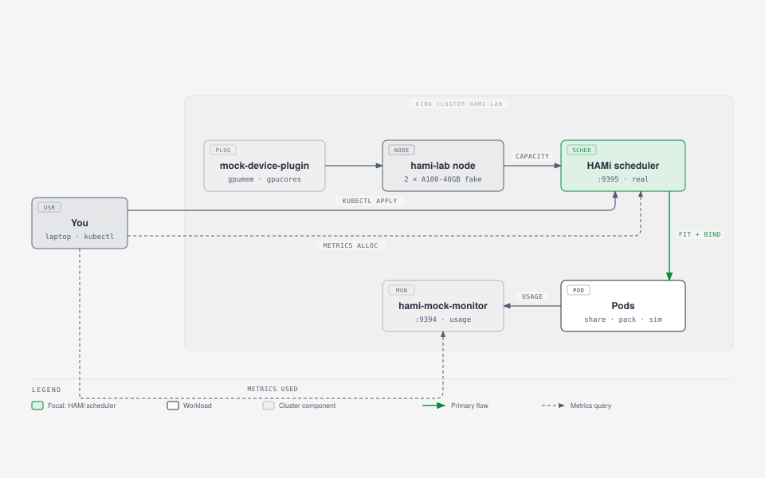

<!--
45 min workshop (ContainerDays 2026 Singapore, Oct 27, 12:30 to 13:15). Plan: gpu_workshop_plan.md.
Lab guide: https://workshop.project-hami.io/labs/containerdays-singapore/#lab-3-scheduler-policies
Lab commands and outputs on these slides are from a run on 2026-10-20 (kind 0.33, kubectl 1.37, helm 4.3, HAMi chart 2.10.0, hami-mock-monitor 86adb51); Labs 2 and 3 re-verified 2026-10-23.
-->
@variant dark
@side-image assets/qr-hami-repo.png
@kicker ContainerDays 2026 Singapore · CNCF Incubating project

# From Zero to Shared&nbsp;GPUs

@subtitle Hands-on GPU Scheduling in Kubernetes with HAMi

@speaker name="Reza Jelveh" role="Solution Architect, Dynamia AI" github=github.com/fishman linkedin=linkedin.com/in/rezajelveh
@speaker name="Jimmy Song" role="VP of Open Source Ecosystem" github=github.com/rootsongjc linkedin=linkedin.com/in/jimmysongio

---

## The 45 minutes

@subtitle October 27, 12:30 to 13:15

::: grid {cols=5}
::: card {tag=cyan}
### 12:30 · Lab 1
Install HAMi. A kind node advertises two fake A100s as vGPU capacity.
:::
::: card {tag=green}
### 12:40 · Lab 2
Share a GPU. Fractional requests, the full interception chain, and a Pod that can never fit.
:::
::: card {tag=yellow}
### 12:50 · Lab 3
Scheduler policies. binpack vs spread on the card axis, and where topology comes in.
:::
::: card {tag=red}
### 13:00 · Lab 4
Beyond the default scheduler. KAI Scheduler, Volcano, and the DRA path.
:::
::: card {tag=cyan}
### 13:10 · Wrap-up
Two metric families, what to try after the session.
:::
:::

Lab guide: **github.com/Project-HAMi/hami-workshop** → Labs → ContainerDays 2026 Singapore

<!--
Ask who has the before-session pull already done. Helpers raise hands so people know who to ask.
-->

---

## Before the session

@subtitle Everything runs on your laptop. The GPUs are fake.

```bash
git clone https://github.com/Project-HAMi/hami-workshop
cd hami-workshop/examples/containerdays-singapore
git clone https://github.com/fishman/hami-mock-monitor
docker pull kindest/node:v1.37.0 busybox:1.36 ghcr.io/llm-d/llm-d-inference-sim:v0.12.0
```

- Needs Docker (or OrbStack / Colima), 4 CPU and 8 GB free, plus `kind`, `kubectl`, `helm`, `jq`, `git`
- Go 1.27+ only to build HAMi or contribute code. A GitHub account for Lab 4
- Conference Wi-Fi is slow. Pull images at home

---

# Why share GPUs

---

## One GPU per task is the default

@subtitle What it costs

Kubernetes allocates GPUs atomically: one whole device, one task.

- A 1 GB task blocks an 80 GB device
- Most GPUs sit idle most of the time
- No advanced scheduling yet: no binpack, no spread, no topology


---

## What is HAMi

@subtitle One GPU, many tasks

<!--
HAMi is a CNCF Incubating project for heterogeneous GPU virtualization in Kubernetes, supporting 10+ GPU/NPU vendors. It slices GPUs and shares them across workloads, without rewriting your stack.
-->


---

## HAMi Capabilities

@subtitle Six things HAMi brings to GPU scheduling

<!--
Six capabilities. The key ones for this workshop: hard isolation, advanced scheduling, and unified monitoring. Heterogeneous management is the differentiator, not just NVIDIA.
-->

::: grid {cols=2}
::: card
### {icon:layers cls=accent-primary} Heterogeneous Management

Manage GPU, NPU, MLU, and other accelerators in one workflow.
:::
::: card
### {icon:shield-check cls=accent-primary} Hard Isolation

Slice memory and compute with hard isolation at runtime.
:::
::: card
### {icon:git-branch cls=accent-contrast} Advanced Scheduling

Binpack, spread, and topology-aware placement policies.
:::
::: card
### {icon:box cls=accent-primary} Kubernetes Native

Kubernetes-native APIs, DRA, and CDI support.
:::
::: card
### {icon:gauge cls=accent-primary} Resource Isolation & QoS

Memory and core quotas for fair, stable sharing.
:::
::: card
### {icon:chart-bar cls=accent-contrast} Unified Monitoring

Consistent metrics and visibility across vendors.
:::
:::

---

@layout two-col

## Asking for a slice

@subtitle One API across vendors, no code changes

- **NVIDIA, Ascend, Cambricon, Hygon, Iluvatar** and more
- **Fine-grained:** memory as small as 1 MB, compute as small as 1% of a card
- **Transparent to tasks:** no code changes required
- **Hard resource isolation** inside containers

@col

```yaml
# NVIDIA: 15 GB and 30% of one card
resources:
  limits:
    nvidia.com/gpu: 1
    nvidia.com/gpumem: 15000
    nvidia.com/gpucores: 30
```

```yaml
# Ascend 910C: 8GB + 20% compute
resources:
  limits:
    huawei.com/Ascend910C: "1"
    huawei.com/Ascend910C-core: "20"
    huawei.com/Ascend910C-memory: "8192"
```

---

## Architecture

1. **Mutating webhook**: routes GPU Pods to `hami-scheduler`
2. **Scheduler extender**: `Filter`, score, `Bind` against per-card state
3. **Device plugin**: registers cards, implements `Allocate`
4. **HAMi-core**: `libvgpu.so` in the container, enforces limits
5. **vGPUmonitor**: per-container usage metrics

Code: `cmd/scheduler`, `cmd/device-plugin`, `cmd/vGPUmonitor`, `pkg/device/<vendor>`

---

## Lab setup: real scheduler, fake GPUs



::: grid {cols=2}
::: card {tag=cyan}
### mock-device-plugin
Turns a node annotation into `nvidia.com/gpumem` and `nvidia.com/gpucores` capacity. The real device plugin writes that annotation from NVML.
:::
::: card {tag=green}
### hami-mock-monitor
Produces HAMi's usage metrics (normally from vGPUmonitor and HAMi-core) from a load source instead of a GPU.
:::
:::

What you do **not** get without a GPU: memory and compute isolation inside the container. That part is HAMi-core, shown live on a real card in the wrap-up.

---

@variant dark
<!--
12:30. Target: 10 minutes. Helpers check everyone gets gpumem=81920.
-->

# Lab 1: Install HAMi

---

## Lab 1: one command

```bash
./setup.sh
```

The script:

1. Creates a kind cluster `hami-lab` and labels the node `gpu=on`
2. Installs HAMi 2.10.0 with the real device plugin off and the mock plugin on
3. Fakes two A100-40GB cards. Two pieces:
    - the count resource `nvidia.com/gpu=20`: the mock plugin's health gate, 2 cards x 10 splits
    - the node annotation `hami.io/node-nvidia-register` from `fake-gpus.json`, what the real device plugin writes after it reads NVML
4. Builds and installs hami-mock-monitor with `completeBinds=true`

Expected at the end:

```json
{ "nvidia.com/gpu": "20", "nvidia.com/gpucores": "200",
  "nvidia.com/gpumem": "81920", "nvidia.com/gpumem-percentage": "200" }
```

---

## Lab 1: look around

```bash
kubectl -n kube-system get pods | grep hami
kubectl -n kube-system get cm hami-scheduler-device -o yaml | less
kubectl get node hami-lab-control-plane \
  -o jsonpath='{.metadata.annotations.hami\.io/node-nvidia-register}' | jq
```

```text
[{"id":"GPU-mock-0","index":0,"count":10,"devmem":40960,"devcore":100,
  "type":"NVIDIA-A100-SXM4-40GB","health":true,"numa":0,"mode":"hami-core"}, ...]
```

- `count`: how many Pods may share the card. `devmem` in MB, `devcore` in percent
- The card list lives on the node, written by the device plugin. The scheduler reads it at `Filter`

<!--
Questions from the guide: Where does the scheduler get the card list from? What would change if health was false?
-->

---

@variant dark
<!--
12:40. Target: 12 minutes. Ask: why is too-big pending when 3 x 15000 < 81920?
-->

# Lab 2: Share a GPU

---

## Lab 2: three Pods, two cards

```bash
kubectl apply -f share.yaml -f too-big.yaml
kubectl get pods -o wide
```

`share-1..3` each ask for 15000 MB and 30% of a card, and run. `too-big` asks for 45000 MB, more than any 40960 MB card, and stays `Pending`:

```bash
kubectl get events --field-selector involvedObject.name=too-big | tail -2
# 0/1 nodes are available: 1 2/2 CardInsufficientMemory.
```

45000 MB fits the node total, but no single 40960 MB card.

---

## Lab 2: read what HAMi decided

```bash
for p in share-1 share-2 share-3; do
  echo -n "$p "; kubectl get pod $p -o jsonpath='{.metadata.annotations.hami\.io/vgpu-devices-allocated}{"\n"}'
done
# share-1 GPU-mock-1,NVIDIA,15000,30:;
# share-2 GPU-mock-0,NVIDIA,15000,30:;
# share-3 GPU-mock-1,NVIDIA,15000,30:;
```

The format is `uuid,type,memory_mb,cores:` per device, `;` per container. The device plugin reads it in `Allocate`.

---

## The interception chain

@subtitle Four steps, one node

1. The admission **webhook** rewrites `schedulerName` to `hami-scheduler`
2. The scheduler **extender** at `Filter` reads the node annotation `hami.io/node-nvidia-register` (the card list from Lab 1), checks memory and core headroom per card, and picks a physical card UUID
3. At `Bind` it writes `hami.io/vgpu-devices-allocated` onto the Pod, sets `hami.io/bind-phase=allocating` and takes the node lock `hami.io/mutex.lock`
4. The device plugin's `Allocate` mounts `/dev/nvidia*` and the vGPU files, reading the target from the Pod annotation, then marks `success` and releases the lock

::: notes{ tag="green" }
The mock plugin skips step 4's completion, which is why hami-mock-monitor's `completeBinds` exists. Without it the next Pod waits up to 5 minutes for the lock.
:::

On a real node, step 4 also injects `libvgpu.so` via `ld.so.preload`, and HAMi-core enforces the memory and core limits from that moment on.

---

@variant dark
<!--
12:50. Target: 12 minutes, now with four concept slides up front (scheduling policies, GPU binpack, GPU spread, topology): keep them to ~3 minutes together, or cut topology to one sentence. The whole workshop already runs over 45 min (see practice/workshop.md cut list). One node, so the node axis has a single candidate. The card axis is fully observable on the two fake A100s.
-->

# Lab 3: Scheduler policies

---

@layout image-right

## Scheduling policies

@subtitle Binpack & spread, on nodes and on GPUs

<!--
Two axes, four patterns. Node binpack saves money, node spread saves uptime. GPU binpack saves whole GPUs for training, GPU spread saves tail latency. Pick by workload: training and small fleets want binpack, inference with SLOs wants spread. (From the KubeCon Japan SNOW talk and OSS Summit Korea.)
-->


- **Node binpack** frees whole machines: reduces cost, helps cluster autoscaler
- **Node spread** isolates faults: HA across zones, blast radius control
- **GPU binpack** prevents fragmentation: frees entire GPUs for training
- **GPU spread** protects tail latency: reduces HBM and NVLink contention

---

@layout two-col

## GPU binpack

@subtitle Fill one card, run many workloads

<!--
GPU binpack puts several workloads on the same card, each with its own slice of memory and compute. It matters most when cards are scarce: small workloads stop blocking whole cards, so the job that cannot share still finds an empty one.
-->

- Several workloads share one card, each with its own slice of memory and compute
- Prevents fragmentation: scattered small workloads no longer block whole cards
- Frees whole cards for the job that cannot share
- Best for: fleets of small workloads, batch jobs, dev and test

@col


---

@layout two-col

## GPU spread

@subtitle One workload per card, no shared bottlenecks

<!--
GPU spread puts each workload on its own card. No tenant shares compute or memory bandwidth with another, so a thrashing neighbour does not slow the others. Use it for latency-sensitive serving. Next: try both on the two fake A100s.
-->

- One workload per card: compute and memory bandwidth are never shared
- Isolates noisy neighbours: a thrasher on one card does not slow the others
- Protects tail latency: no cross-tenant contention
- Best for: latency-sensitive serving with strict SLOs

@col


---

@layout image-right

## Scheduling policies

@subtitle Topology-aware

<!--
NVLink vs PCIe is a 7-14x bandwidth gap. HAMi schedules multi-GPU workloads to NVLink-connected pairs and avoids PCIe bridge pairs. Ascend uses HCCS, other vendors have their own high-speed interconnects: same topology logic applies. This matters for tensor parallelism and large-model training. (From the KubeCon Japan SNOW talk.)
-->


- **NVLink 3 (A100):** 600 GB/s, 12 links
- **NVLink 4 (H100/H200):** 900 GB/s bidirectional across 18 links
- **NVLink 5 (B200/B300):** 1.8 TB/s, 14x PCIe 5.0
- **NVLink 6 (Rubin):** ~3.6 TB/s target
- **PCIe 5.0 x16:** 128 GB/s. **PCIe 6.0:** 242 GB/s
- **HAMi topology policy:** prefers NVLink (NVIDIA), HCCS (Ascend), and other high-speed interconnects, avoids PCIe bridge pairs

---

## Placement happens on two axes

| Axis | Annotation | binpack | spread |
| --- | --- | --- | --- |
| Which node | `hami.io/node-scheduler-policy` | fewer nodes | across nodes |
| Which card on that node | `hami.io/gpu-scheduler-policy` | same card | across cards |

- Both axes score cards by utilization ratios: binpack prefers the fuller card (consolidation), spread prefers the emptier one (dispersion)
- This lab has one node, so the node axis has a single candidate
- The card axis is fully observable on the two fake A100s

---

## Lab 3: binpack

```bash
kubectl delete -f share.yaml -f too-big.yaml
kubectl apply -f binpack.yaml
for p in pack-1 pack-2; do
  echo -n "$p "; kubectl get pod $p -o jsonpath='{.metadata.annotations.hami\.io/vgpu-devices-allocated}{"\n"}'
done
```

Both Pods report the same `GPU-mock-X`: two workloads sharing one card. Frees whole cards for big jobs.

---

## Lab 3: spread

```bash
kubectl delete -f binpack.yaml
kubectl apply -f spread.yaml
for p in spread-1 spread-2; do
  echo -n "$p "; kubectl get pod $p -o jsonpath='{.metadata.annotations.hami\.io/vgpu-devices-allocated}{"\n"}'
done
```

One Pod per card. Same cluster, same requests, different policy, different placement.

```yaml
metadata:
  annotations:
    hami.io/gpu-scheduler-policy: spread   # or binpack, per Pod
```

---

## Topology awareness

- The allocation annotation names an exact card UUID, and card choice is a topology decision: on a multi-GPU node it decides NVLink and PCIe locality
- `fake-gpus.json` carries a `numa` field per card, the same hint the real device plugin records from the driver
- Card-level spread keeps Pods on separate cards, binpack packs them onto one
- Explicit topology-aware placement across cards and nodes is what the schedulers in the next lab add

---

@variant dark
<!--
13:00. Target: 10 minutes. Read-along section: no live installs, 10 minutes does not fit them and one fake node does not need them.
-->

# Lab 4: Beyond the default scheduler

---

## HAMi is two things

@subtitle One isolation layer, several scheduling brains


- A **capacity model**: the extended resources plus the scheduler extender you just used
- **HAMi-core**: the isolation library
- Other schedulers can replace the placement brain and keep the isolation layer

---

## Three ways to use HAMi

::: grid {cols=3}
::: card {tag=cyan}
### Standard HAMi
HAMi scheduler extender + HAMi device plugin.
`nvidia.com/gpu`, `gpumem`, `gpucores`
:::
::: card {tag=green}
### Volcano vGPU
Volcano `deviceshare` + volcano-vgpu-device-plugin.
`volcano.sh/vgpu-number`, `vgpu-memory`, `vgpu-cores`
:::
::: card {tag=yellow}
### KAI Scheduler
KAI GPU sharing + kai-resource-isolator.
`gpu-memory` or `gpu-fraction` annotation
:::
:::

All three use **HAMi-core** in the container for isolation. One rule: one device-plugin path per GPU node.

---

## KAI Scheduler: composes with HAMi

NVIDIA's scheduler for AI workloads (CNCF Sandbox): gang scheduling, hierarchical fair queues, fractional GPU, topology-aware placement.

```bash
helm install kai-scheduler oci://ghcr.io/nvidia/kai-scheduler --version v0.17.0 \
  --set global.gpuSharing=true --set binder.plugins.hamicore.enabled=true \
  -n kai-scheduler --create-namespace
```

- Since v0.16.4 the kai-resource-isolator DaemonSet plus a mutating webhook deliver the same `libvgpu.so` into Pods
- `CUDA_DEVICE_MEMORY_LIMIT` injected from `gpu-fraction` or `gpu-memory` annotations
- KAI makes the placement decisions, HAMi-core makes the memory cap hard

---

## Volcano: gang jobs on shared GPUs

```yaml
kind: Job                    # batch.volcano.sh/v1alpha1
spec:
  schedulerName: volcano
  minAvailable: 2            # both workers or none
  queue: vgpu-queue
  tasks:
  - replicas: 2
    template:
      spec:
        containers:
        - resources:
            limits:
              volcano.sh/vgpu-number: 1
              volcano.sh/vgpu-memory: 2000
              volcano.sh/vgpu-cores: 30
```

- Takes the vGPU path instead of the standard HAMi chart: Volcano `deviceshare` plugin plus the volcano-vgpu-device-plugin
- Queue `capability` caps vGPU memory per team, even when the node has room
- Never run the standard HAMi device plugin and a Volcano vGPU plugin on the same node

---

## DRA: the resource model changes

- **HAMi-DRA** is a mutating webhook that rewrites `nvidia.com/gpu` requests into DRA ResourceClaims
- The same Pod spec keeps working on Kubernetes 1.34+ with the DRA Consumable Capacity feature gate and CDI enabled in the runtime
- A ResourceClaimTemplate mode exists for Kueue admission
- Your Pod YAML does not change, the machinery underneath does

github.com/Project-HAMi/HAMi-DRA

::: notes{ tag="green" }
No live installs in this slot: 10 minutes does not fit them and one fake node does not need them. Try the Volcano vGPU tutorial at home: project-hami.io/tutorials/labs/volcano-vgpu-gang-queue
:::

---

@variant dark
<!--
13:10. Target: 5 minutes. The sim oscillates over 2 minutes, give it time. Then the live isolation demo if the real node is up.
-->

# Wrap-up

@subtitle Two metric families, what to try after the session

---

## Reserved is not used


HAMi exposes two metric sets. Keep them apart: one is a reservation, the other is usage.

```bash
./metrics.sh scheduler   # allocation, port 9395
./metrics.sh monitor     # usage, port 9394
```

---

## Two metric sources

::: grid {cols=2}
::: card {tag=cyan}
### Scheduler :9395, allocation
- `gpu_memory_allocated_bytes`
- `gpu_core_allocated_ratio`
- `node_gpu_memory_allocated_ratio`
- `gpu_shared_count`
- `vgpu_memory_allocated_bytes`
- `resource_quota_used`
:::
::: card {tag=green}
### vGPUmonitor :9394, usage
- `vgpu_memory_used_bytes`
- `vgpu_memory_limit_bytes`
- `container_device_utilization_ratio`
- `host_gpu_utilization_ratio`
- `host_gpu_memory_used_bytes`
- `container_last_kernel_elapsed_seconds`
:::
:::

All names start with `hami_`. Same labels: `node`, `device_uuid`, `namespace`, `pod`. Join them in PromQL.

---

## Give the mock a realistic load

```bash
kubectl apply -f sim.yaml      # llm-d-inference-sim, requests oscillate 0 to 5
watch -n 5 "./metrics.sh monitor | grep 'pod=\"sim\"'"
```

```text
hami_container_device_utilization_ratio{pod="sim"} 26.4
hami_node_gpu_memory_allocated_ratio{device_uuid="GPU-mock-1"} 0.73
hami_host_gpu_utilization_ratio{device_uuid="GPU-mock-1"}      20.0
```

- `sim` is a vLLM-compatible inference simulator: utilization moves between 0 and 33 (load x allocated cores)
- Memory stays at 0.9 x the limit, because vLLM preallocates its KV cache

**Question.** Card `GPU-mock-1` shows 73% memory allocated but 20% used. Which number goes on a capacity dashboard, and which on a cost report?

---

## Live: isolation on a real GPU

::: grid {cols=2}
::: card {tag=cyan}
### Ask
`nvidia.com/gpumem: 3000`
:::
::: card {tag=green}
### See
`nvidia-smi` in the Pod reports 3000 MiB total.
:::
:::

Allocating past the limit fails inside the Pod with out of memory. Neighbours keep running.

<!--
Presenter only, real NVIDIA node. This is the part the lab cannot show: HAMi-core enforcement. Pre-recorded fallback if the node is down.
-->

---

## After the session: HAMi WebUI

`metrics.sh` is fine for a terminal, but the HAMi WebUI turns the same numbers into dashboards. It needs a Prometheus in the cluster:

```bash
helm repo add prometheus-community https://prometheus-community.github.io/helm-charts
helm repo add hami-webui https://project-hami.github.io/HAMi-WebUI
helm upgrade --install prometheus prometheus-community/kube-prometheus-stack \
  --version 75.15.1 -n monitoring --create-namespace --set grafana.enabled=false --wait
kubectl apply -f monitoring.yaml   # scrape :9395 and :9394
kubectl apply -f webui-rules.yaml  # translate metric names for the WebUI
helm upgrade --install my-hami-webui hami-webui/hami-webui \
  --set externalPrometheus.enabled=true --set dcgm-exporter.enabled=false \
  -n kube-system --wait
kubectl -n kube-system port-forward svc/my-hami-webui 3000:3000
```

Open http://localhost:3000.

---

## Why `webui-rules.yaml`


- The WebUI queries vGPUmonitor's metric names (`hami_memory_size`, `hami_core_util`, `hami_container_vgpu_allocated`, ...)
- This lab's scheduler and mock monitor expose the newer byte/ratio names (`hami_gpu_memory_limit_bytes`, `hami_host_gpu_utilization_ratio`, ...)
- The PrometheusRule records one set as the other. Without it every allocation and usage panel stays empty

::: notes{ tag="green" }
Pre-pulling for an offline room: `--set image.*.digest=""` makes the chart use the v1.3.0 tags, which matters because digest references cannot be re-tagged after kind load.
:::

---

## After the session: contribute

::: grid {cols=4}
::: card {tag=cyan}
### HAMi
`make test`. Start in `Fit`, `PatchAnnotations` (`pkg/device/nvidia/device.go`) or `Filter`, `Bind` (`pkg/scheduler/scheduler.go`). `git commit -s`.
:::
::: card {tag=green}
### HAMi-DRA
The webhook that turns `nvidia.com/gpu` requests into DRA ResourceClaims. Needs Kubernetes 1.34+.
:::
::: card {tag=yellow}
### mock-device-plugin
Complete the bind in `Allocate` (a patch is prepared in `hami-mock-monitor/upstream/mock-device-plugin`), or add a vendor.
:::
::: card {tag=red}
### hami-mock-monitor
Other vendors (Ascend, Hygon), a Grafana dashboard for the lab, a published image.
:::
:::

Look for `good first issue`. Open a draft PR before you leave. Disclose AI help in the PR.

---

## Clean up

```bash
kind delete cluster --name hami-lab
```

---

## Where HAMi Is Today

@subtitle Production metrics from CNCF case studies

::: grid {cols=4}
::: card {metric}
0
Driver, kernel, code changes needed
SF Technology
:::
::: card {metric}
1-2 GB
Memory per small-model inference service
KE Holdings
:::
::: card {metric}
4x
GPU utilization: 5-10% to 30-50%
NIO
:::
::: card {metric}
90%
GPU infra managed by HAMi on RTX 4070/4090
Prep Edu
:::
:::

::: notes{ tag="green" }
China Merchants Bank - SNOW Corp. - NIO - KE Holdings - DaoCloud - SF Technology - Prep Education - cncf.io/case-studies
:::

---

@layout ecosystem
## Community & Adopters

@subtitle Devices, integrations, and who uses HAMi

<!--
5k stars, 700k+ pulls, 500+ contributors, 27 countries. 13 device types, 20+ adopters. The QR code links to github.com/Project-HAMi/HAMi.
-->

#### Open Source, CNCF Backed, Production Ready
::: grid {cols=5}
::: card {metric}
5k
Github Stars
:::
::: card {metric}
700k
Docker Pulls
:::
::: card {metric}
500+
Contributors
:::
::: card {metric}
27
Contributor Countries
:::
::: card

     
:::
:::

#### Ecosystem & Device Support
::: grid {cols=2}
::: card


    
   

 
:::
:::
:::

#### Adopters
::: grid {cols=2}
::: card
    
    
    
    
:::
:::

---

---

@variant dark

# Thank you

@subtitle github.com/Project-HAMi/HAMi · project-hami.io · lab: github.com/Project-HAMi/hami-workshop

@speaker name="Reza Jelveh" role="Solution Architect, Dynamia AI" github=github.com/fishman linkedin=linkedin.com/in/rezajelveh
@speaker name="Jimmy Song" role="VP of Open Source Ecosystem" github=github.com/rootsongjc linkedin=linkedin.com/in/jimmysongio
